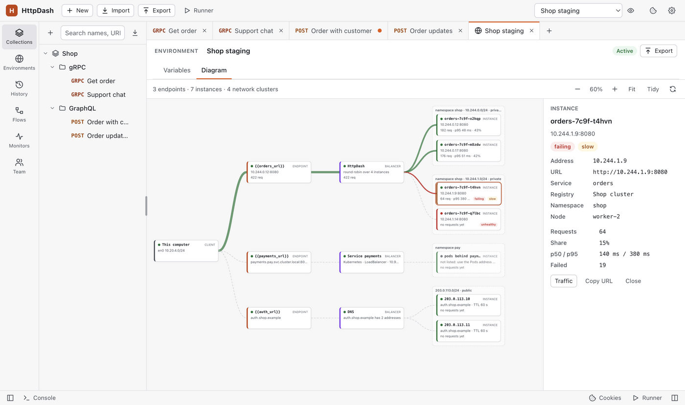
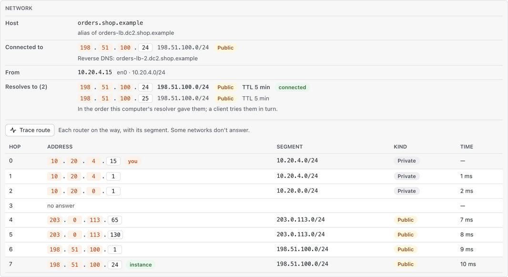
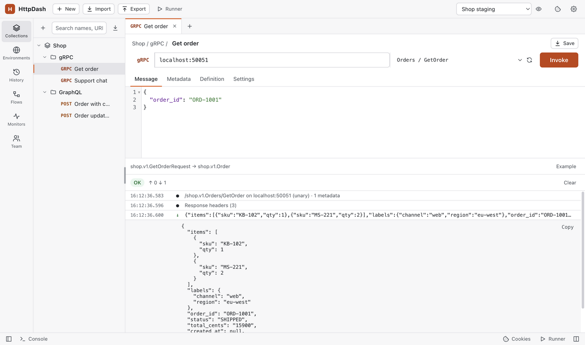
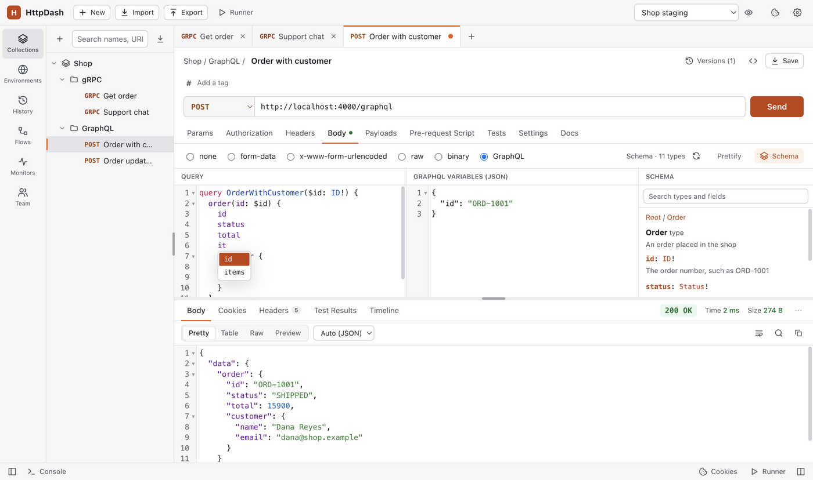

# HttpDash

[](https://github.com/gethttpdash/httpdash/actions/workflows/build.yml)
[](LICENSE)
[](https://github.com/gethttpdash/httpdash/releases/latest)

**A free, source-available API client that runs your Postman collections and scripts, keeps everything on your machine, and logs in for you.** No account, no cloud. For macOS, Windows and Linux.

**Built for service-heavy backends and for AI agents.** It reads your service registry (Consul, Eureka, Kubernetes), so `{{orders_url}}` always points at live instances. It spreads requests over every instance, counts what each one answers, and finds the instance that answers differently. AI agents can build requests and scripts, run data-driven collections and read the results over MCP, with the permissions you choose. It also reads a service's health while your request runs and shows where each request went on the network. Its collection runner is about 16 times faster than Postman's.

[Website](https://httpdash.com) · [Download](https://github.com/gethttpdash/httpdash/releases/latest) · [User guide](USERGUIDE.md) · [Changelog](CHANGELOG.md) · [Sponsors](#sponsors)


## What it does

- **Runs your Postman collections unchanged:** collections, environments and globals (v2.0 / v2.1), pre-request and test scripts with the `pm` API and Chai, in a QuickJS sandbox. Also imports OpenAPI 3.0 / 3.1, Swagger 2 and cURL.
- **Logs in for you:** a login request runs first when the token is missing or expired, and the token is saved and reused. [Auth dependencies](USERGUIDE.md#auth-dependencies-auto-refresh-tokens)
- **Environments from your service registry:** Consul, Eureka, Kubernetes, custom JSON or an OpenAPI document, kept in sync. [Service discovery](USERGUIDE.md#service-discovery-auto-create-environments)
- **Every instance of a service:** spread requests over them, count what each answered, and compare their answers to find the one that differs. [Load balancing](USERGUIDE.md#load-balancing-and-traffic-by-instance) · [Compare](USERGUIDE.md#compare-instances)
- **What the server went through:** its health endpoint read before, during and after your request. [Health](USERGUIDE.md#health-while-it-runs-profiling)
- **Where the request went:** addresses, segments, reverse DNS, your network adapter and a route trace. [Network](USERGUIDE.md#where-a-request-went-on-the-network)
- **A diagram of each environment:** its service endpoints, the load balancers in front of them and the instances behind, grouped into network clusters, with live traffic on every line. Drawn from discovery, DNS and the requests you send, with no agent in your services. [Environment diagrams](USERGUIDE.md#environment-diagrams)
- **Into internal networks without a VPN:** SSH jump hosts and SOCKS5. [Tunnels](USERGUIDE.md#tunnels-into-internal-networks)
- **AI agents alongside you:** Claude and other agents read, send, run and edit through OpenAPI or MCP, with permissions you choose. [AI agents](USERGUIDE.md#ai-agents-openapi-and-mcp)
- **In CI and the terminal:** a Newman-style runner with JUnit reports, and `httpdash send`, which works like curl through the app. [Command line](USERGUIDE.md#command-line-runner-ci-and-schedulers)
- **For teams:** sharing through any git repository, with secrets kept local. [Team sharing](USERGUIDE.md#team-sharing-through-git)
- **gRPC and GraphQL:** gRPC calls of every kind from `.proto` files or server reflection, and GraphQL with schema autocomplete, an explorer and subscriptions. [gRPC](USERGUIDE.md#grpc-requests) · [GraphQL](USERGUIDE.md#graphql)
- **And more:** request versions and spec warnings, tags and search, monitors, mock servers, WebSocket and Server-Sent Events, client certificates, a secret scan, an audit log, and an app lock with LDAP sign-in. [Everything](USERGUIDE.md#features-at-a-glance)

Built with Electron and plain JavaScript. Your data stays on your computer as JSON files.

## How it compares

|  | HttpDash | Postman | Insomnia | Bruno | Hoppscotch | Yaak |
| --- | --- | --- | --- | --- | --- | --- |
| License | [FSL-1.1-ALv2](#license), source-available (Apache 2.0 after two years) | Proprietary | Apache-2.0 | MIT | MIT | MIT source; commercial use of the builds needs a licence |
| Environments from a service registry (Consul, Eureka, Kubernetes) | ✅ | —¹ | — | — | — | — |
| Requests spread over every instance, traffic per instance, instances compared | ✅ | — | — | — | — | — |
| Diagram of an environment's endpoints, load balancers, instances and network clusters | ✅ | — | — | — | — | — |
| MCP server for AI agents | ✅ built in | ✅ | MCP client only² | Community servers³ | ✅ separate package | ✅ plugin |
| Agents run collections with data files over MCP | ✅ | — | — | — | — | — |
| Agents see and use the app's screen | ✅ | — | — | — | — | — |
| Agents can reach local and private-network APIs | ✅ | — | — | — | Off by default⁴ | ✅ |
| Secret values hidden from agents unless you allow them | ✅ | — | — | — | No⁴ | — |
| gRPC | ✅ | ✅ | ✅ | ✅ | Not confirmed | ✅ |
| GraphQL | ✅ with subscriptions | ✅ | ✅ | ✅ | ✅ | ✅ |

A dash means we found no such feature in their documentation, as of October 2026. Tools change quickly; if a row is out of date, please [open an issue](https://github.com/gethttpdash/httpdash/issues/new/choose) and we'll fix it.

1. Postman's Insights Agent can discover the services in a Kubernetes cluster to fill its API Catalog. It doesn't resolve service addresses for the requests you send.
2. Insomnia's MCP client is for testing MCP servers; it doesn't let agents work in Insomnia.
3. Community MCP servers wrap Bruno's command line; an official one is reported to be in early development.
4. Hoppscotch's MCP server blocks private and loopback addresses by default, and returns stored credentials in plain text.

## Download

Get the latest version for your system from the [releases page](https://github.com/gethttpdash/httpdash/releases/latest):

- **macOS:** Intel and Apple Silicon (`.dmg` or `.zip`)
- **Windows:** x64 and ARM64 installers, and a portable app for x64
- **Linux:** x64 and ARM64, as an AppImage or a `.deb`

On first launch, macOS may say it "could not verify HttpDash is free of malware": open **System Settings → Privacy & Security** and click **Open Anyway**. On Windows, SmartScreen may warn: choose **More info → Run anyway**. Details are in the [user guide](USERGUIDE.md#install-and-update).

## Quick guide

1. **Bring your requests in.** Click **Import** in the top bar, or drag files onto the window: Postman collections and environments, an HttpDash backup, an OpenAPI or Swagger document, or a link to one. To start from a cURL command, paste it into the URL bar.
2. **Pick an environment** in the top bar, then send a request with **Send** or Ctrl/Cmd+Enter. The response shows its body, headers, tests and a timeline of exactly what was sent.
3. **Let it log in for you.** In a collection's **Authorization** tab, set Bearer Token to `{{token}}`, choose **Run a request first** under **Auth dependency**, pick your login request and say where the token is in its response (for example `access_token`).
4. **Run a collection.** Open **Runner**, pick a collection or folder (and which of its requests), an environment and a data file if you have one, then run it.
5. **Run it in CI.** With Node.js 22 or later:

   ```bash
   npm install -g github:gethttpdash/httpdash
   httpdash run backup.json -c "Orders API" -e "Staging" --env-var password=$API_PASSWORD -r cli,junit
   ```

6. **Let an AI agent in.** Turn on **Settings → AI access**, choose what agents may do, then, for Claude Code: `claude mcp add httpdash -- httpdash mcp`.
7. **Share with your team.** Open **Team** in the sidebar, connect a git repository, tick what to share and click **Sync**.

Everything else, from service discovery to tunnels, is in the [user guide](USERGUIDE.md).

## Screenshots

| | |
| --- | --- |
|  Test scripts and results |  Timeline of the exact request sent |
|  JSON body with dynamic variables |  OAuth 2.0 token helper |
|  Code generation |  Collection runner with a data file |
|  Environments (dark theme) |  Console |
|  Compare instances |  Traffic by instance and payload |
|  Health while the request ran |  Where the request went on the network |
|  Versions and a spec warning |  Tags and the search that suggests |
|  AI agents at work |  A JSON response as a table |
|  An environment's endpoints, load balancers and instances |  The route from you to the instance |
|  A gRPC call from server reflection |  GraphQL autocomplete and schema explorer |

## Not included

Compared with Postman, these are not implemented: Socket.IO and MQTT requests; NTLM, Hawk and Akamai auth; API documentation publishing and hosted cloud sync (team sharing works through git instead).

## Sponsors

HttpDash has no account, no ads and no paid tier. Thank you to the sponsors who keep it going:

| | |
| --- | --- |
|  | **[Juris](https://jurisjs.com)**: just JavaScript, not a framework: a non-blocking, reactive platform for building web apps that run anywhere. |
|  | **[limer.sh](https://limer.sh)**: an ultra-fast HTTP server and load balancer in C that routes on what is inside the request. |
|  | **[FittestOwl](https://fittestowl.com)**: free spelling bee, mental math, memory and Bible verse games for kids. |
|  | **[RC Tuners](https://rctuners.com)**: for every RC, on land, water and air: chat, share setups and plan the next meet. |

**Partner:**  **[OpenCore MES](https://opencoremes.com)**, a low-code manufacturing execution system. HttpDash is built for the demands of its APIs and tested against its real services.

**Support HttpDash:** [become a sponsor](https://httpdash.com/sponsors.html#sponsor) as a company (write to [contact.httpdash@gmail.com](mailto:contact.httpdash@gmail.com)), [buy me a coffee](https://buymeacoffee.com/restiguayw), or star the repository and tell a colleague.

## Contributing

Bug reports, fixes and features are welcome. [CONTRIBUTING.md](CONTRIBUTING.md) explains how to set up, build, find your way around the source and send a pull request. If a Postman collection behaves differently in HttpDash, please [open an issue](https://github.com/gethttpdash/httpdash/issues/new/choose) with it. Report security problems privately, as described in [SECURITY.md](SECURITY.md).

## License

HttpDash is free to use and its source is available, under the [Functional Source License, Version 1.1, ALv2 Future License](LICENSE) (FSL-1.1-ALv2):

- **You may** use HttpDash for any purpose, at work or at home, and read, modify and share its code, except for a *Competing Use*: offering HttpDash, or something built from it, as a commercial product or service that competes with it.
- **After two years**, each version becomes available under the [Apache License 2.0](https://www.apache.org/licenses/LICENSE-2.0) as well, with no restrictions on competing use.
- **Earlier versions:** HttpDash 1.2.0 and earlier were released under the MIT License, and remain so.

Third-party code keeps its own license, such as the bundled copy of chai (MIT).
