# HttpDash

[](https://github.com/gethttpdash/httpdash/actions/workflows/build.yml)
[](LICENSE)
[](https://github.com/gethttpdash/httpdash/releases/latest)

**A free, source-available API client that runs your Postman collections and scripts, keeps everything on your machine, and logs in for you.** No account, no cloud. For macOS, Windows and Linux.

Built for demanding microservice APIs: it builds environments from your service registry, spreads requests over every instance and counts what each answers, compares instances side by side, reads a service's health while your request runs, shows where each request went on the network, and lets AI agents work alongside you. Its collection runner is about 16 times faster than Postman's.

Website: [httpdash.com](https://httpdash.com) · [Download](https://github.com/gethttpdash/httpdash/releases/latest) · [Changelog](CHANGELOG.md) · [Contributing](CONTRIBUTING.md)

Built with Electron and plain JavaScript (no build step).

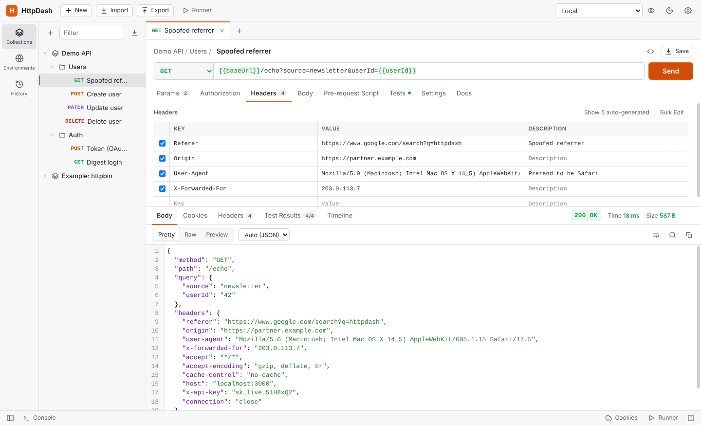

## Run it

```bash
npm install
npm start
```

Run the engine's unit tests (HTTP client, auth, scripts, runner, importers, code generation) with `npm test`.

Data is stored as JSON in Electron's `userData` folder (Settings → Data shows the path). Set `HTTPDASH_DATA_DIR` to use a different folder.

## Download / build for macOS, Windows and Linux

Every push and pull request runs the GitHub Actions workflow in `.github/workflows/build.yml`, which tests the app and then builds:

| Platform | Files |
| --- | --- |
| macOS (Intel and Apple Silicon) | `HttpDash-<version>-mac-x64.dmg`, `…-mac-arm64.dmg`, plus `.zip` versions |
| Windows (x64 and ARM64) | `HttpDash-Setup-<version>-x64.exe` / `-arm64.exe` installers, and a no-install `HttpDash-<version>-portable.exe` |
| Linux (x64 and ARM64) | `HttpDash-<version>-linux-x86_64.AppImage` / `-arm64.AppImage` for any distribution, and `httpdash_<version>_amd64.deb` / `_arm64.deb` for Debian and Ubuntu |

Download them from the workflow run's **Artifacts**. Pushing a tag such as `v1.0.0` also attaches them to a GitHub Release.

To build locally, run `npm run dist:mac` on a Mac, `npm run dist:win` on Windows, or `npm run dist:linux` on Linux or a Mac. Output goes to `dist/`.

**Updates.** **Help → Check for Updates…** asks GitHub whether a newer release exists and links to it. HttpDash never checks on its own.

**Code signing.** Without certificates, the Mac build is ad-hoc signed and the Windows build is unsigned:
- **macOS:** the first launch is blocked with "Apple could not verify HttpDash is free of malware". Click **Done**, then open **System Settings → Privacy & Security**, scroll down and click **Open Anyway**. Or run `xattr -dr com.apple.quarantine /Applications/HttpDash.app` in Terminal. (Right-click → Open no longer works on macOS 15 and later.)
- **Windows:** SmartScreen may warn. Choose **More info → Run anyway**.

To sign (and notarize on Mac), add these repository secrets; the workflow picks them up automatically:
- macOS: `MAC_CSC_LINK` (base64 .p12), `MAC_CSC_KEY_PASSWORD`, `APPLE_ID`, `APPLE_APP_SPECIFIC_PASSWORD`, `APPLE_TEAM_ID`
- Windows: `WIN_CSC_LINK`, `WIN_CSC_KEY_PASSWORD`

## Team sharing through git

Share collections and environments with your team through any git repository: GitHub, GitLab, Bitbucket, Azure DevOps, Gitea or your own server. Open **Team** in the sidebar and connect a repository:

1. **Repository:** enter its URL (HTTPS or SSH), the branch, and optionally a folder, so the workspace can live inside an existing project repository.
2. **Sign-in:** either use this computer's git (SSH keys, Git Credential Manager, stored credentials), or save an access token. Tokens are encrypted with the system keychain and kept out of the workspace, exports and the repository.
3. **Shared items:** tick the collections and environments to share, then click **Sync**.

Teammates connect the same repository and click **Get latest**; the shared items appear in their sidebar with a team badge.

- **Sync** saves your shared items, commits them (with your message, or a summary of what changed), merges teammates' changes and pushes.
- **Get latest** brings in teammates' changes without pushing yours.
- **Conflicts:** each request is its own file, so two people rarely edit the same file. When they do, HttpDash lists the files and you choose **Keep mine**, **Keep the team's** or **Cancel sync**. Changes to other items merge either way.
- **Secrets stay local:**
  - Secret variables and auth-dependency tokens are written with empty values; everyone keeps their own.
  - Before pushing, the secret scan checks what is about to be shared and warns about plain-text credentials.
- **Open tabs:** tabs follow the team's version unless they have unsaved edits.
- **History:** recent commits are shown, and every sync is recorded in the audit log.

Git must be installed (it usually is on macOS; on Windows, install it from git-scm.com). The repository holds readable JSON, so changes can also be reviewed in pull requests:

```
httpdash.json
collections/orders-api/_collection.json        collection settings and variables
collections/orders-api/orders/_folder.json
collections/orders-api/orders/list-orders.request.json
environments/staging.json
```

| | |
| --- | --- |
| 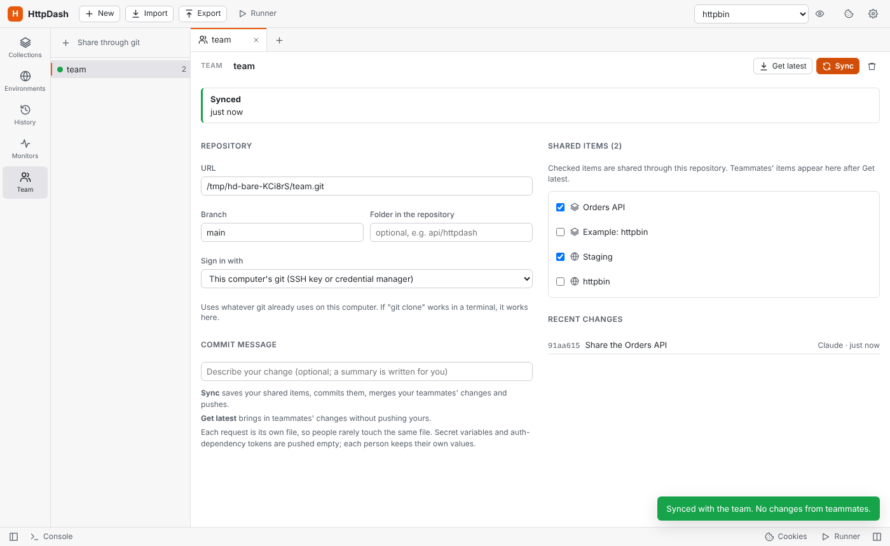 Connecting a repository | 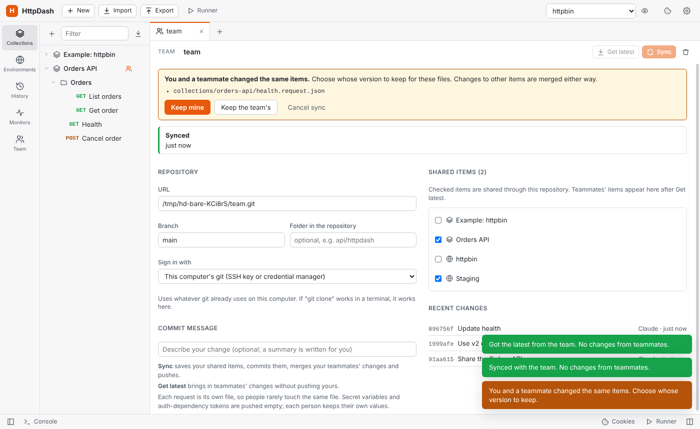 Choosing whose version to keep |

## Command-line runner (CI and schedulers)

Run collections without opening the app, like Postman's Newman. The runner needs Node.js 22+:

```bash
npm install -g github:gethttpdash/httpdash     # or, in a clone: npm run cli -- run …
httpdash list backup.json
httpdash run backup.json -c "Orders API" -e "Staging" --env-var password=$API_PASSWORD -r cli,junit
httpdash send '{{orders_url}}/orders' -e Staging      # one request through the running app, like curl
```

- **Input:** an HttpDash backup (**Export → HttpDash backup**, ideally with "Leave out secrets"), a Postman collection, or a `workspace.json`.
- **Environments:** pick one by name from the backup with `-e`, or pass a Postman environment file.
- **Secrets in CI:** pass them with `--env-var key=value`.
- **Other options:**
  - `-n` for iterations and `-d data.csv` for data-driven runs.
  - `--folder`, `--tag` (repeat it to require several tags), `--bail`, `--delay-request`, `--timeout-request`.
  - `--socks5 host:port` to send every request through a SOCKS5 proxy; `--no-tunnels` to ignore the backup's tunnels.
  - `-k` to skip SSL verification.
  - Client certificates with Newman's flags: `--ssl-client-cert`, `--ssl-client-key`, `--ssl-client-passphrase`, `--ssl-client-cert-list` (Newman's JSON format) and `--ssl-extra-ca-certs`.
  - Reporters: `cli`, `json` and `junit` (JUnit XML is read by Jenkins, GitLab, Azure DevOps and GitHub test reporters).
- **What carries over from the app:** auth dependencies and scripts work exactly as in the app, and each request's health line is printed when a health URL is set.
- **Exit codes:** `0` all passed, `1` a test or request failed, `2` bad arguments or input.

## AI agents (OpenAPI and MCP)

AI agents such as Claude can use HttpDash the way you do: read your collections and environments, send requests and read the responses, set up the Runner and get the results, compare instances, check service discovery traffic, add and change requests, and see and use the screen (a snapshot of the visible controls they can click, type into, expand and scroll, plus screenshots).

Turn it on in **Settings → AI access** and choose what agents may do: **Read** (always on), **Run**, **Edit**, **Control the screen**, and **Reveal secrets** (off unless you choose it; secret values and credentials are masked otherwise). It listens on `127.0.0.1` only, every call needs the token shown there, and calls from web pages are refused. The status bar shows when an agent is working, and **AI access** lists every call; **Pause** stops them, and a new token locks out the old one.

- **Claude Code:** `claude mcp add httpdash -- httpdash mcp` (with the CLI installed: `npm install -g github:gethttpdash/httpdash`)
- **Claude Desktop:** add `{"mcpServers": {"httpdash": {"command": "httpdash", "args": ["mcp"]}}}` to `claude_desktop_config.json`
- **Anything else:** the OpenAPI document is at `http://127.0.0.1:47823/openapi.json`; send `Authorization: Bearer <token>`.

### Instead of curl: test an endpoint and keep it

An agent (or you) can send through HttpDash rather than with curl, and keep what works:

- **MCP / OpenAPI:** `sendAdHoc` with `collection` (and `folder`) runs the request inside that collection, so its auth and automatic login apply: leave `auth` out and it inherits them. With `save`, a request that succeeded (2xx or 3xx, no failed tests; `saveIf: "always"` keeps any) is kept there, with its response as an example and the tag `ai`. A request with the same method and URL in that folder is updated instead of duplicated; missing folders and the collection are created. Saving needs the **Edit** permission, and the answer says what was saved.
- **Terminal:** `httpdash send` works like curl, through the running app:

  ```bash
  httpdash send '{{orders_url}}/orders/ORD-1001' -c "Orders API" --folder Orders --save -t smoke
  httpdash send POST https://api.example.com/orders --json '{"qty":3}' -e Staging -i
  ```

  `-X`, `-H`, `-d` / `--json` (`@file` reads a file), `-e` for the environment, `-c` / `--folder` / `--save` / `--save-always` / `--name` / `-t` to keep it, `-i` for the status and headers, `-v` for timing, instance, health and network details, and `-f` to exit with 22 on a status of 400 or more. The body goes to stdout, so it pipes into `jq`.

`httpdash mcp` finds the port and token by itself while the app runs. Start with `getStatus`; `sendRequest` sends a saved request; `startRun` then `getRun` runs the Runner; `getUiSnapshot`, `uiAction` and `takeScreenshot` work the screen.

## Monitors

**Monitors** (sidebar) run a collection or folder on a schedule, from every minute to every 24 hours, against a chosen environment.
- **Results:** success rate, a duration chart, run history with the failed tests, and desktop notifications when a monitor fails or recovers.
- **Variables:** changes such as refreshed tokens can be kept.
- **When they run:** while HttpDash is open and unlocked. For round-the-clock checks, schedule the command-line runner with cron, Windows Task Scheduler or your CI.

## Mock server

Each collection has a **Mock server** tab that serves the examples saved on its requests. To save one, send a request, then use the response's "…" menu → **Save as example**.

- **Starting it:** pick a port, an optional delay, and whether other devices on your network may connect; then start it. **Use in an environment** creates a copy of your environment whose `{{BASE_URL}}`-style variables point at the mock, and switches to it.
- **Matching:** routes match on method and path. `:id` and `{{variable}}` segments match any value, and literal segments win.
- **Choosing an example:** clients can pick a specific one with the `x-mock-response-name` or `x-mock-response-code` header.
- **Other behaviour:**
  - CORS is enabled.
  - Requests without examples answer 501 with a hint, and unknown paths list the available routes.
  - Recent requests are shown live.
  - Mock servers stop when the app locks or quits.

## Secret scan and audit log

**Tools → Scan for Secrets** (also in Settings → Security and the Export dialog) looks for credentials typed directly into requests:
- AWS, GitHub, Slack, Stripe and Google keys, private keys and JWTs;
- passwords in URLs;
- plain-text auth fields and `Authorization`/key/token headers;
- secrets in scripts and bodies;
- sensitive-looking variables that aren't marked secret.

One click moves a value into a secret variable (keeping prefixes like `Token {{…}}`) or marks a variable as secret.

**Tools → Audit Log** keeps a local record (`audit.log`, rotated at 5 MB) of app starts, sign-ins and locks, lock setting changes, exports and imports, requests sent, collection and monitor runs, and mock servers. It records who, when and what. Request entries store only method, host, path and status, never headers, bodies or query values. You can filter, export (JSON Lines) or clear it; clearing is itself recorded.


## App lock with LDAP sign-in

HttpDash can require a directory (LDAP) sign-in before it opens. Set it up in **Settings → Security**:

1. **LDAP server:**
   - Enter the server address: `ldap://…:389` or `ldaps://…:636`, with optional StartTLS and certificate verification.
   - Choose how to find the user. Either a DN template such as `uid={username},ou=people,dc=example,dc=com`, or search then bind: a service account searches a base with a filter such as `(uid={username})`. Use the second when users live in different branches.
   - Optionally require membership of a group. HttpDash checks `member`, `uniqueMember` and `memberUid`.
2. **Test a sign-in** with your own account.
3. **Turn the lock on**, which is only possible after a successful test of the current settings:
   - Choose which users may unlock.
   - Optionally lock after N minutes of inactivity.
   - Save the one-time **recovery code**.

Once on, HttpDash starts locked. You can lock it any time with the lock button in the top bar or **Ctrl/Cmd+L**.

- **What locked means:** the main process refuses to hand any workspace data to the window until a sign-in succeeds, so nothing is in the window to read.
- **Recovery code:** if the LDAP server is unreachable, the code unlocks HttpDash and turns the lock off, so you can fix the settings.
- **Changing settings:** with the lock on, the LDAP settings are read-only. Turning the lock off requires signing in again.
- **Safety measures:**
  - Empty passwords are refused, because many LDAP servers treat them as an anonymous bind that "succeeds".
  - Usernames are escaped before they go into LDAP filters and DNs.
  - Repeated failures are slowed down.
  - The service-account password is encrypted with the OS keychain.
  - Lock settings live in their own `security.json`, which backups never include.
- **Limitation:** the lock protects the app; it does not encrypt your data files on disk.

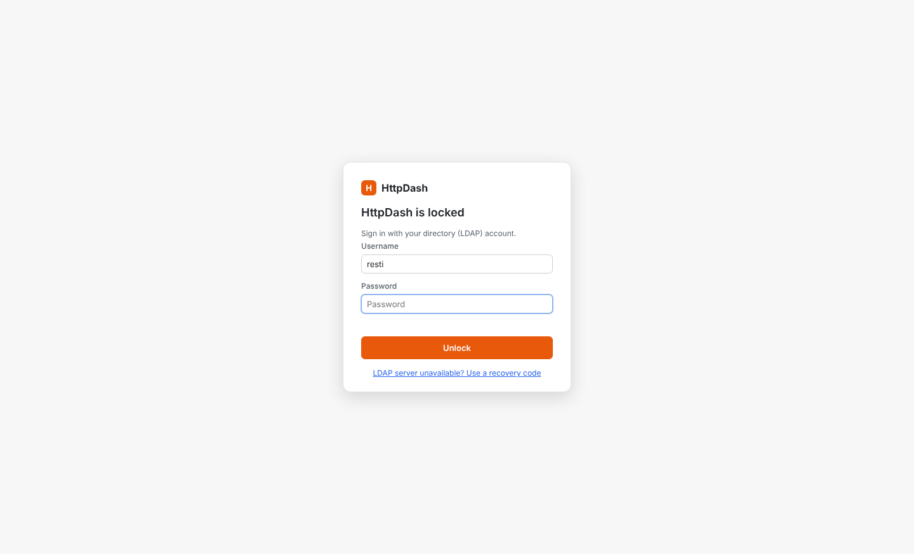

## Import and export everything

**Export** (top bar) offers two formats:
- **HttpDash backup:** one `.json` file with everything: collections, environments, globals, history, service discovery sources, settings and cookies.
- **Postman format:** a folder with one `.postman_collection.json` per collection, one `.postman_environment.json` per environment, and a globals file, ready for Postman or teammates. Auth dependencies and discovery sources are HttpDash-only, so they are not in these files.

Tick **Leave out secrets** before sharing an export. This empties secret variables and the variables holding auth-dependency tokens, removes credentials typed into auth fields (references like `{{token}}` are kept), and drops discovery tokens, the proxy password and cookies. Without it, the file contains your credentials.

**Import** accepts all of these, and several files can be selected at once (for example a whole Postman export folder). For a backup, you choose:
- **Merge:** adds everything; items that already exist are added as copies marked "(imported)", and existing global keys are kept.
- **Replace:** swaps your current workspace for the backup. It asks for confirmation first.

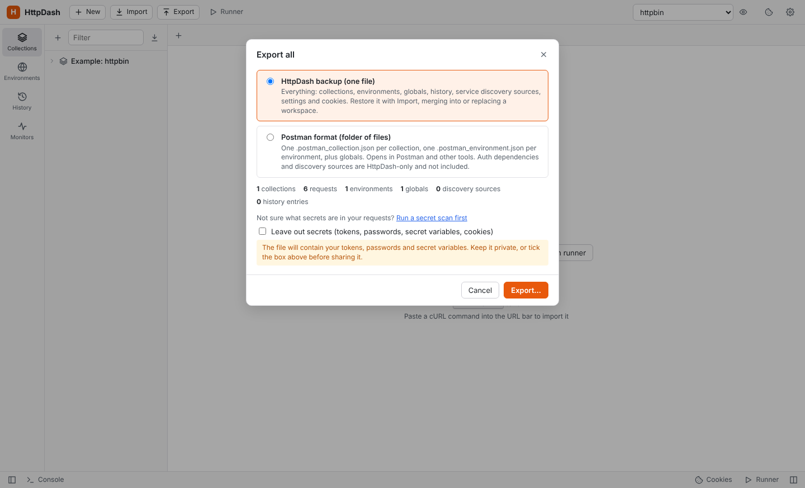

## Auth dependencies (auto-refresh tokens)

A collection, folder or request can name another request, such as **Login**, to run first when the token it needs is missing or expired. Set it up in the **Authorization** tab under **Auth dependency**:

1. Set the collection's auth to **Bearer Token** with `{{token}}`.
2. Choose **Run a request first** and pick the login request.
3. Fill in where the token sits in the login response, for example `access_token` or `data.access_token`, and optionally the `expires_in` path.

On every send, HttpDash checks `{{token}}`:
- **Empty or expired:** it runs the login request first, saves the new token (and its expiry) in the environment, then sends your request.
- **Still valid:** it sends your request straight away.

Expiry comes from the expiry variable, which is computed from `expires_in`. If there's no expiry variable, it uses a JWT token's `exp` claim. The token is refreshed 30 seconds early by default.

More details:
- **Retry on 401:** optionally, if the server still answers 401, it refreshes the token and retries once.
- **Inheritance:** requests and folders inherit the setting, or can override it or turn it off.
- **No loops:** the login request never depends on itself.
- **Collection Runner:** it logs in once and reuses the token, even if the login request is unticked in the run.
- **Visibility:** the response shows a banner when a dependency ran, and the Timeline shows its details.

Auth dependencies are saved in HttpDash's workspace. Postman's export format has no field for them, so they are not included when you export to Postman.

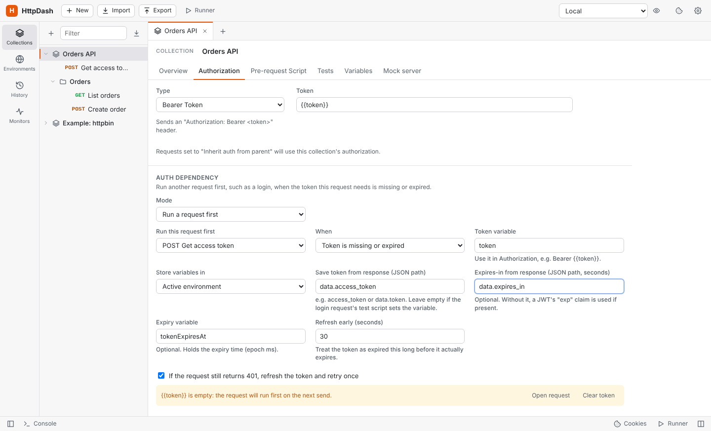

## Service discovery (auto-create environments)

Point HttpDash at a service registry and it builds an environment with one variable per service. For example, `{{orders_url}}` = `http://10.0.1.5:8080`, so requests can use `{{orders_url}}/api/orders`.

To add a registry, open **Environments** in the sidebar and click **Service discovery → +**.

| Registry | What it reads |
| --- | --- |
| Consul | `/v1/catalog/services` plus each service's healthy instances. Options: ACL token, datacenter, tag filter, http/https. |
| Eureka (Spring Cloud) | `/eureka/apps`, instances with status UP only. Uses each app's home page URL or its host and port. |
| Kubernetes | Services in a namespace (or `*` for all), using a service-account bearer token and an optional label selector. The address can be the cluster DNS name, the cluster IP, or the external LoadBalancer address. |
| Custom JSON | Any endpoint returning a list of services or a `{ "name": "url" }` map. You set the list path, the name field, and a URL field or template such as `http://{host}:{port}`. |
| OpenAPI document | The document's server becomes a base URL variable, and every operation becomes a request in a collection that follows the document (see below). |

- **Preview services** shows what would be created, without changing anything.
- **Create environment** makes the environment the first time.
- **Sync / Re-sync** updates the same environment in place: changed URLs are updated, new services are added, and services that vanished are removed (unless you tick "keep"). Variables you added yourself, such as API keys, are never touched.
- **Variable names** follow a pattern: `{name}_url` by default, or `{NAME}_BASE` for upper case.
- **Startup sync:** each source can be set to sync automatically when HttpDash starts.
- **Settings:** registry requests use your proxy settings, and SSL verification can be turned off per source (useful for Kubernetes API servers with self-signed certificates).

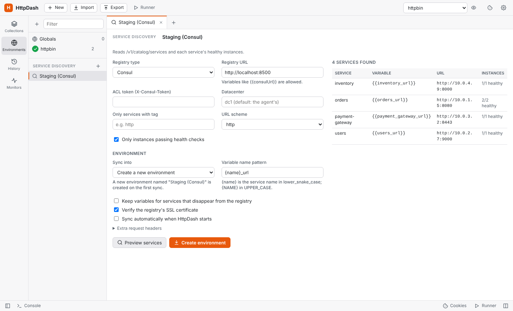

### OpenAPI documents, versioned

A source pointed at an OpenAPI (Swagger) document, JSON or YAML, keeps a collection with one request per operation. Each sync records the document's version and a fingerprint, so an unchanged document changes nothing. A new one is compared with the last: added, changed and removed operations are listed before anything is written, and you apply them when you're ready. Your own edits (values, scripts, tests, requests you added) are kept, and the report says where the document changed something you edited too.

Each operation's shape is kept as well, so a request, and each of its versions, is checked against the document. A banner says when the operation is gone or deprecated, a required parameter or field is missing, a value isn't one the spec allows, or it sends something the spec doesn't know.

### Load balancing and traffic by instance

When a service has several instances, requests that use its variable can go to **the first instance**, **each in turn** (round robin) or **a random one**, in Send, the Runner and Monitors. Unhealthy instances are skipped. Behind a load balancer, set the **instance header** (such as `X-Served-By`) and requests are counted by the instance that answered.

The source's **Traffic** page shows, live, what each instance answered: requests, share, p50 and p95 times, status codes and connection errors. Slow and failing instances are flagged, and so are instances that left the pool. The latest requests are listed with the gap between them. Export the report to Excel, CSV, PDF, an image, an HTML page, Markdown or JSON.

### Payloads

Give a request the variations it should be called with (typed in, or imported from CSV or JSON rows) and send them in turn or at random. Each payload has its own rotation over the instances. Traffic is counted per payload too, so a payload that is slow on every instance can be told apart from an instance that is slow for every payload. The same goes for network segments: **By network segment** appears when instances answer from more than one.

### Compare instances

**Compare**, next to Send, sends the request to every healthy instance of the service in its URL (the source is synced again first), or to every address its host resolves to in DNS (round-robin DNS, Kubernetes headless services). It compares the answers (status, headers and every field of a JSON body) and names the instance that answered differently, with each difference: `X-Version` 2.3.0 where the others say 2.4.1, a missing `qty`, a different `state`.

- Values that differ on every instance by nature (ids, timestamps, the instance's own name) are set apart, and can be ignored for the request with one click (`items[*].updatedAt` covers every item).
- Headers that always vary, such as `Date` and request ids, are ignored.
- Each instance's status, time, tests and address are listed, and **Show** opens its full answer.
- A POST, PUT, PATCH or DELETE asks first, since it runs once per instance.

## Request versions and spec warnings

Every distinct version of a request you send by hand (method, URL, params, headers, body, auth) is kept with the response it got. Open **Versions** in the request's header to switch back to one and see its response straight away. Sending the same thing again doesn't make a new version. Name and tag versions in **Manage versions**; named and tagged versions show up in the sidebar search. Runs and monitors don't add versions, and versions stay in your workspace (they aren't exported or shared). Each request keeps 50, the named and tagged ones longest.

When a request comes from an OpenAPI source, it and each of its versions are checked against the document: versions that no longer fit are marked ⚠ in the versions menu.

## Tags and search

Tag requests (`smoke`, `orders`, `admin`, as many as you like) in the field under the request's name, which suggests the tags already in use. The sidebar search becomes a dropdown as you type, built from every request's tags, methods, URLs and names, most used first. Pick one and it becomes a chip; chips combine (every tag, any of the methods, plus the text you add). `tag:`, `method:`, `url:` and `name:` narrow the suggestions.

The Runner's request picker uses the same search, so `#smoke` then **All** runs the smoke tests, and the CLI has `--tag`. Tags travel with team sharing and survive a Postman export and import.

## Health while it runs (profiling)

Give a request, a folder or a collection a **health URL**, and HttpDash reads it before the request is sent, while it is in flight, and after it answers. You see what the server went through while it handled your request: connections or transactions held, queues, memory, a database that went down.

Set it up in a folder's or collection's **Health** tab, or in a request's **Settings** tab:

- **Health URL:** a path such as `/healthz` or `/actuator/health` is read on each request's own host. So a request sent to one instance (through service discovery or Compare) reads that instance's health. A full URL such as `{{mes_url}}/healthz` is read as written.
- **Read every (ms):** how often to read it while the request is in flight, 250 ms by default. The first reading goes out with the request, so even a fast request has one, and readings never overlap.
- **Only these fields:** optional, one JSON path per line. `db.transactions` covers everything under it.
- **Send the request's Authorization header:** for health endpoints that need it.
- **Read it now:** reads the endpoint once and lists every field, with **Watch** to pick the ones you care about.

The response gets a **Health** tab:
- whether the service said it was healthy in every reading (a 4xx/5xx answer, `ok: false`, or `status` other than `UP`/`ok`/`pass` counts as unhealthy)
- the fields that changed, with their value before, their range during and their value after, and a small chart of each numeric field over time with the request's own span shaded
- the fields that didn't change, and every reading with its status and how long the health endpoint took to answer.

Health readings never fail the request itself; an endpoint that can't be reached is shown as an unhealthy reading. The Collection Runner shows one line per request (`healthy throughout; db.transactions.waiting 0 → 3 → 0`), the CLI prints it under each request, and the AI API's `sendRequest` returns it.

## Where a request went on the network

The **Timeline** tab has a **Network** section for every request:

- **Host:** the name you called, and the names it is an alias of (CNAME), in order.
- **Connected to:** the address the request was sent to, split into its octets with the network segment highlighted (`10 . 42 . 7 . 31`, segment `10.42.7.0/24`). It also shows the kind of address (private, shared/VPN `100.64.0.0/10`, loopback, link-local, public), its reverse-DNS name (often the host, rack or data center), and whether it sits on one of your own computer's segments.
- **From:** your own address and the network adapter the request left from (Ethernet, Wi-Fi, a VPN).
- **Resolves to:** every address the name resolves to, in the order your resolver gives them, each with its segment, kind and TTL, and the one that was used marked. If DNS servers asked directly give a different answer than your computer's resolver (hosts file, VPN or split DNS), it says so.
- **Trace route:** runs your system's `traceroute` (`tracert` on Windows) and lists each hop with its address, segment and time. It takes a few seconds, and some networks don't answer.

Through a proxy, the address shown is the proxy's, and the trace says so. Segment size is /24 for IPv4 and /64 for IPv6 by default; change it, or turn tracing off, in **Settings → General**. Lookups are cached for a minute, so a collection run asks once per host.

For services from service discovery, the **Traffic** page adds a **By network segment** table when instances answer from more than one segment, so a slow data center or VLAN stands out from a slow instance. It's in every export format too, and **Compare** shows the address each instance answered from.

## Streaming responses (Server-Sent Events)

When a response is `text/event-stream`, as with AI APIs that stream their answers, HttpDash shows each event the moment it arrives instead of waiting for the end. It works with any method and body, so a `POST` to a completion endpoint just works.

- While streaming, the response pane lists events live, with the time since the request was sent, and the Send button becomes **Stop**.
- **Stop** keeps everything that arrived, so you can inspect a long or endless stream.
- Afterwards, the **Events** view lists every event (name, data, id); click one to see its data pretty-printed and copy it. The raw stream is still in **Raw**, and test scripts run as usual when the stream ends.
- Events are parsed exactly as browsers do: multi-line `data`, `event`, `id`, `retry` and comments, with any line endings.

## WebSocket requests

Create one with **New → WebSocket Request**, or **Add WebSocket request** on a collection or folder. It's saved like any request (shown as **WS**), so it lives in collections and syncs with your team.

- **Connect** to a `ws://` or `wss://` URL. `{{variables}}` work in the URL, headers and messages.
- **Handshake:** your headers, plus the auth inherited from the collection or folder (Bearer, Basic, API key, OAuth 2.0…) and matching cookies, are sent with the handshake. Subprotocols go in **Settings**. Client certificates, trusted CAs, the proxy and SSL verification apply as for HTTP. Click the "Connected" line in the log to see the exact handshake.
- **Messages:** write text or JSON and press **Send** (Ctrl/Cmd+Enter). Save messages you use often and reuse them with one click.
- **Log:** everything sent (↑) and received (↓) with times and sizes. Click a message to see it pretty-printed and copy it; filter as you type. Pings are answered automatically, and the close code and reason are shown when the connection ends.
- If the server refuses the upgrade, its status and response body are shown, so a 401 or 403 is easy to diagnose.

The collection runner, mock servers and Postman export skip WebSocket requests.

## Tunnels into internal networks

Reach services on a private network (a plant, a data center, a Kubernetes cluster) without a VPN. Add tunnels in **Settings → Tunnels**:

- **SSH jump host:** HttpDash runs your system's `ssh` with dynamic port forwarding (`ssh -D`), so your keys, `ssh-agent`, `~/.ssh/config` and known hosts work as they do in a terminal. Optional: user, port, key file, and other jump hosts to go through first (`ssh -J`). It opens on first use and stays open; if it drops, the next request opens it again. ssh runs in batch mode, so it never waits for a password: use a key. A new host key is refused unless you tick **Accept a new host key the first time**, and a changed one is always refused.
- **SOCKS5 proxy:** any SOCKS5 server, with an optional user name and password.

Each tunnel carries the hosts you list, one per line: names with `*` wildcards (`*.mes.corp`) or address ranges (`10.42.0.0/16`). An environment can instead send all its requests through one tunnel (**Tunnel** under its color), or through none. Host names are resolved on the far side, so internal DNS names work.

Everything goes through the tunnel: Send, the Runner, Monitors, Compare, health reads, WebSockets, and the app's own calls such as service discovery syncs, OAuth sign-ins and imports from a URL. A Consul server inside a plant is reached the same way as its services. The Timeline shows the time the tunnel took and notes that the address and route are on the far side, and the status bar shows while a tunnel is open (red if it failed). **Open** / **Check** opens a tunnel and can try a `host:port` through it.

The CLI uses the tunnels saved in a backup (with the environment's choice), or `--socks5 host:port` for every request, for example through an `ssh -D` started by your CI job. `--no-tunnels` ignores the saved ones.

## Client certificates and custom CAs

For APIs that use mutual TLS, add a client certificate in **Settings → Certificates**:

- **Host:** a name such as `api.example.com`, or a wildcard such as `*.example.com`. Optionally add a port; leave it empty to match any port.
- **Files:** a CRT and KEY file (PEM), or a PFX/P12 file. Add the passphrase if the key or PFX has one.
- The first enabled certificate that matches the request's host is used, on every hop of a redirect and through a proxy. The response **Timeline** shows which one was sent.
- Certificate files are read when needed, so renewed certificates are picked up without restarting.

**Certificates installed on this computer** are trusted by default, as in a browser: HttpDash reads your system's store (macOS Keychain, Windows certificate store, the Linux system bundle) as well as its built-in list, so a company CA that IT has installed just works. You can turn this off in **Settings → Certificates**.

**CA certificate** adds a certificate authority from a PEM file to the trusted ones, for CAs that aren't installed on the computer, so internal HTTPS servers work without turning off SSL verification.

TLS settings are built once and reused, so client certificates and extra CAs don't slow requests down.

Passphrases are left out of exports when you tick **Leave out secrets**. If a server asks for a certificate you haven't added, or the passphrase is wrong, the error says so in plain words.

## Spoofing Referer, Origin, User-Agent and other headers

Requests are sent from Node's HTTP stack, not a browser, so none of the browser's "forbidden header" rules apply. Whatever you put in the **Headers** tab is sent exactly as written, including:
- `Referer`, `Origin` and `User-Agent`
- `Host` (useful for virtual hosts)
- `Cookie` (overrides the cookie jar for that request)
- `X-Forwarded-For` and other `Sec-*` headers

The header-name field autocompletes common headers. A custom `Referer` is kept when redirects are followed.

Some of these are set automatically if you don't set them (User-Agent, Accept, Accept-Encoding, Cache-Control, Host, Content-Type, Content-Length). Your own value always wins; **Show auto-generated** in the Headers tab lists them. The default User-Agent can be changed in Settings.

## Features

**Requests**
- Any HTTP method, URL bar with `{{variable}}` highlighting, hover tooltips and autocomplete
- Query params table synced with the URL, path variables (`/users/:id`), headers with bulk edit
- Bodies: raw (JSON / XML / HTML / JavaScript / text, with beautify and JSON linting), `form-data` with file uploads, `x-www-form-urlencoded`, binary file, GraphQL (query + variables)
- Auth: inherit from parent, Basic, Bearer, API key (header or query), Digest, AWS Signature v4, and OAuth 2.0 with every common grant:
  - **Authorization Code**, with or without **PKCE**, and **Implicit**: sign in in an HttpDash window, which catches the redirect to any registered callback URL, or in your own browser with a callback on `127.0.0.1` (RFC 8252)
  - **Client Credentials** and **Password**
  - Refresh tokens, expiry display and "Sign Out of Providers". Tokens you get by signing in are never shared through team sync; each person keeps their own.
- Per-request settings: follow redirects, SSL verification, cookies, timeout
- Paste a cURL command into the URL bar to import it
- **Tags** on requests, suggested as you type, and **versions**: every request you send by hand is kept with its response, to switch back to in a click
- Connections are kept open and reused (keep-alive), so repeat requests skip DNS, TCP and TLS

**Responses**
- Status, time and size, with a breakdown of DNS / connect / TLS / first byte
- Pretty (JSON / XML / HTML formatting), **Table**, Raw, Preview (sandboxed HTML, images) and Visualize (`pm.visualizer.set` with Handlebars-style templates)
- **Table view** for JSON: arrays of objects become sortable tables, objects become key/value tables, and nested values open as tables in place. Filter rows as you type. Long tables are virtual (only the rows on screen are drawn), so a 100,000-row response opens in about 0.1 s and scrolls smoothly, even when the big array is nested inside another object.
- **Export** a table as an Excel workbook, CSV (UTF-8, opens correctly in Excel) or a PNG image, following the current filter and sort. Nested objects become dotted columns (`address.city`); Excel cells keep numbers and booleans typed, with a bold, frozen header.
- Search, line wrap, copy, save to file, save as example
- Large responses (over 2 MB by default) show their first 512 KB until you click **Show all**, so the window never freezes
- Headers, cookies, test results with filters, and a timeline showing the request actually sent and any redirects
- **Network** (in the timeline): every address the host resolves to, the one it connected to in octets and segments, your network adapter, and a route trace
- **Health:** what the service's health endpoint said before, during and after the request, when a health URL is set
- **Compare:** the same request sent to every instance of a service, and the one that answered differently

**Scripts** (Postman-compatible `pm` API)
- Pre-request and test scripts on collections, folders and requests, run in Postman's order
- `pm.environment` / `globals` / `collectionVariables` / `variables` / `iterationData`, `pm.request` (headers, URL, query, body), `pm.response` (`json()`, `text()`, `headers`, `code`, `responseTime`)
- `pm.test`, `pm.expect` (Chai), `pm.response.to.have.status(...)` / `.header(...)` / `.jsonBody(...)` / `.jsonSchema(...)` / `.be.success` and similar
- `pm.sendRequest`, `pm.setNextRequest`, `pm.cookies`, `pm.visualizer`, `pm.execution.skipRequest`
- `CryptoJS` (MD5, SHA-1/224/256/384/512 and their HMACs, encoders), `atob` / `btoa`, `Buffer`, `URL` / `URLSearchParams`, `TextEncoder` / `TextDecoder`, `setTimeout`, `console.*` output in the Console panel, and legacy `tests[...]`, `postman.*`, `responseBody`
- `require` for `chai`, `crypto-js`, `util`, `url` and `buffer`
- Every script runs in an isolated sandbox with no access to Node or your files
- Snippet library in the script editor

**Organisation**
- Collections and nested folders with drag-and-drop, rename, duplicate, delete and "Copy as cURL"
- Collection / folder settings: description, auth, scripts, collection variables
- Environments (with secret values and a color that tints the top and bottom bars while active), globals, environment quick look, dynamic variables (`{{$guid}}`, `{{$timestamp}}`, `{{$randomEmail}}`, …)
- A sidebar search that suggests from every request's name, URL, method and tag, with chips that combine
- History grouped by day, multiple tabs with unsaved-change tracking, all restored on restart

**Collection Runner**
- Run a collection or folder, and pick its requests from a tree or by tag; environment, iterations and a gap in milliseconds between requests
- 500 requests with scripts and tests in about a third of a second (`npm run bench` compares it with Newman and Bruno)
- CSV / JSON data files (one iteration per row), `pm.setNextRequest` flow control, stop on failure
- Live results with per-request tests, request/response details and exportable JSON results
- Optionally persists variable changes made during the run

**Import / export & tools**
- Import HttpDash backups, Postman collections (v2.0 / v2.1), environments and globals, OpenAPI 3.0 / 3.1 and Swagger 2 (JSON or YAML) and cURL; drag files onto the window to import
- OpenAPI imports keep each operation's examples (request bodies, parameters and responses), so the collection's **mock server** works right away, and turn security schemes into auth settings (Bearer, Basic, API key, and OAuth 2.0 including PKCE). They follow `$ref`s, read OpenAPI 3.1 types, and handle large specs: GitHub's 10 MB API description imports in about a second.
- Export everything as a restorable backup or as Postman files, or export single collections, environments and globals
- Code generation: cURL, raw HTTP, JavaScript fetch, Node.js Axios, Python requests, Go, PHP cURL, C# HttpClient, Java OkHttp, PowerShell, wget
- Cookie manager (view / add / edit / delete per domain)
- Settings: timeout, redirects, SSL verification, connection reuse, HTTP proxy (including HTTPS via CONNECT, with auth and bypass list), tunnels (SSH jump hosts and SOCKS5) into internal networks, network tracing and segment size, user agent, response size limit, light / dark / system theme, editor font size, stacked or side-by-side layout
- Console panel with network and script logs; keyboard shortcuts (Ctrl/Cmd+T, Enter, S, W, O)

## Screenshots

| | |
| --- | --- |
| 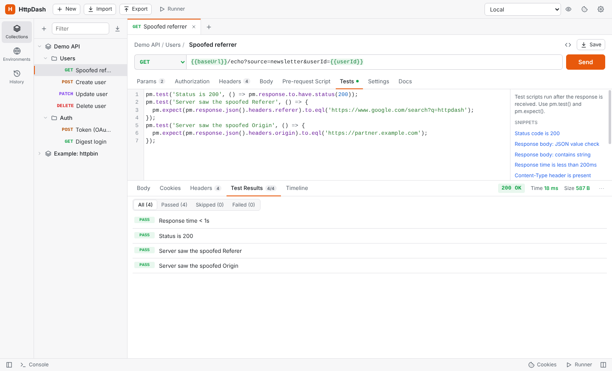 Test scripts and results |  Timeline of the exact request sent |
| 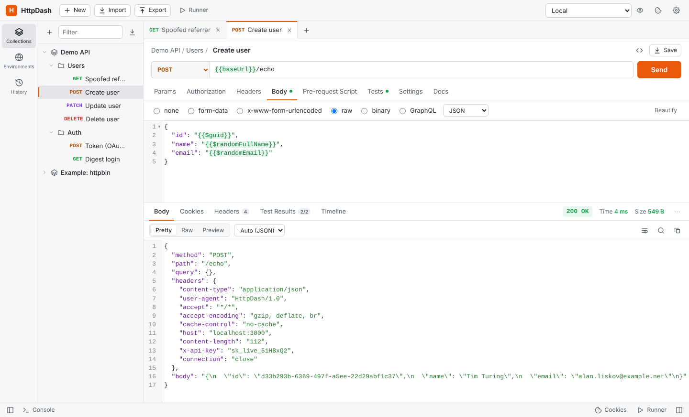 JSON body with dynamic variables | 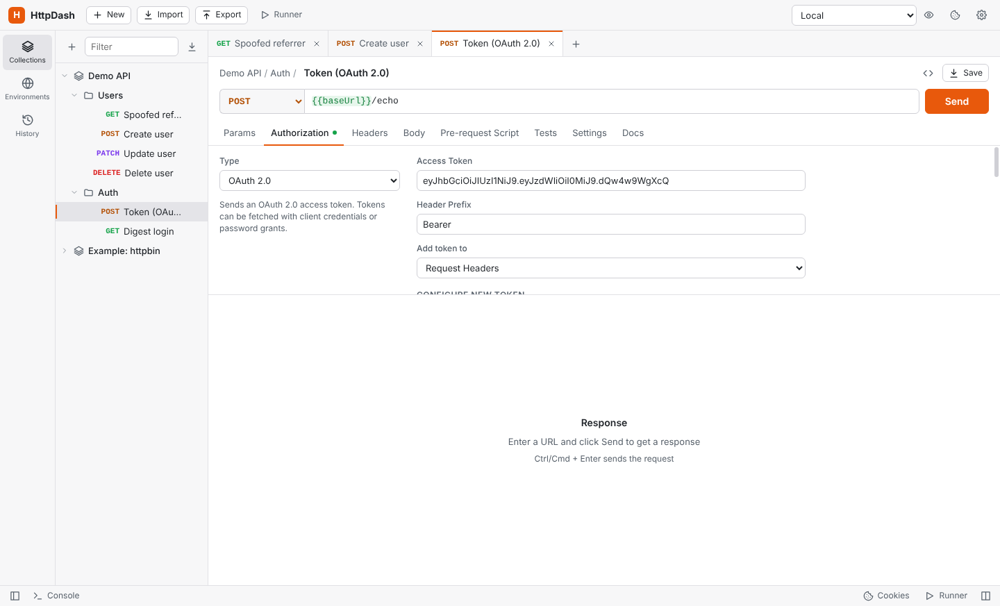 OAuth 2.0 token helper |
| 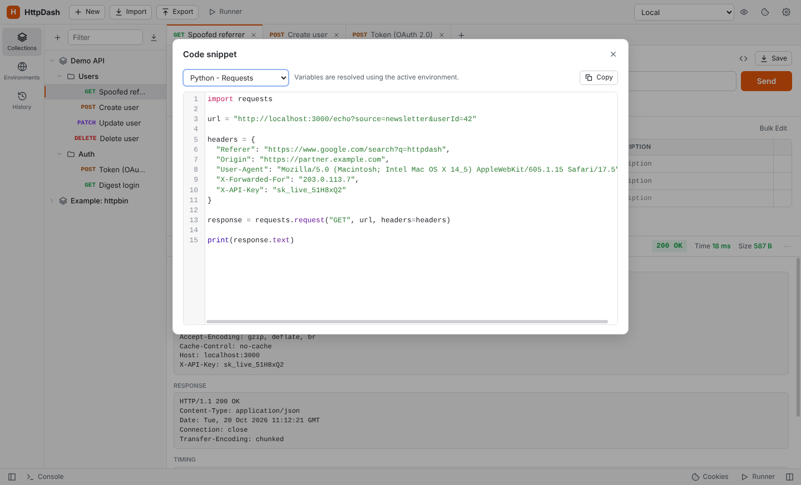 Code generation | 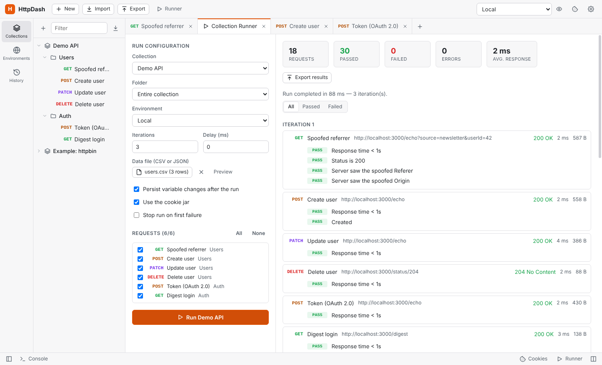 Collection runner with a data file |
| 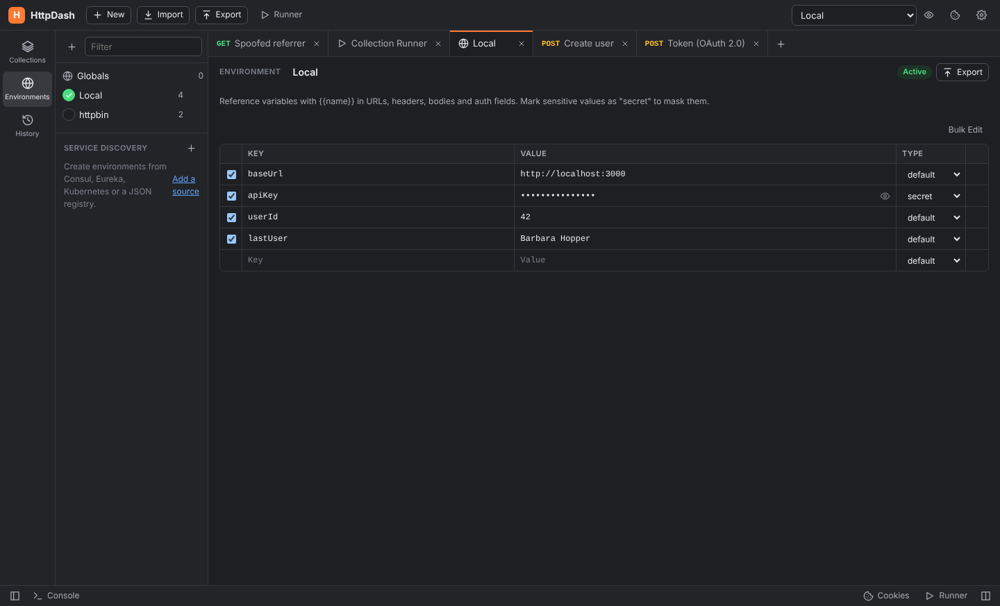 Environments (dark theme) |  Console |
| 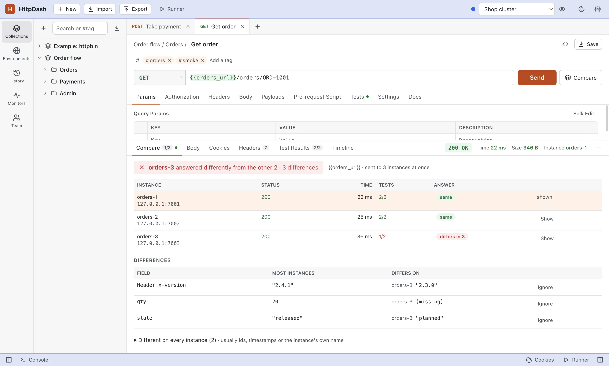 Compare instances | 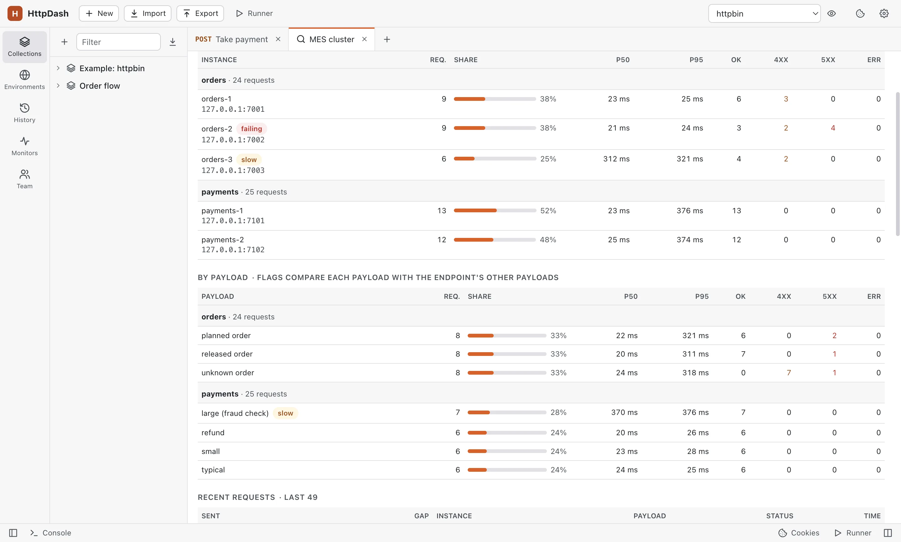 Traffic by instance and payload |
| 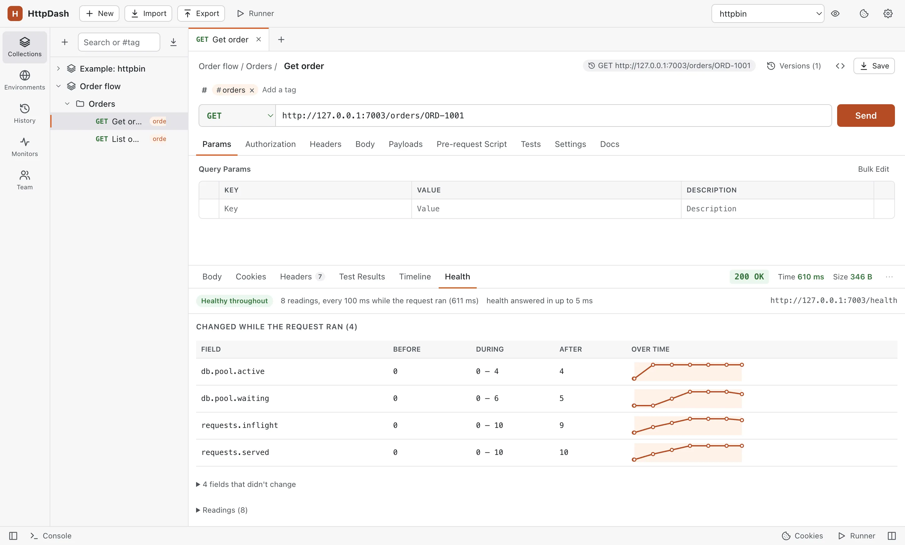 Health while the request ran | 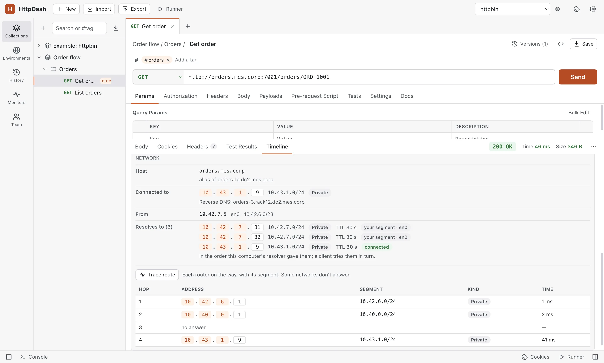 Where the request went on the network |
| 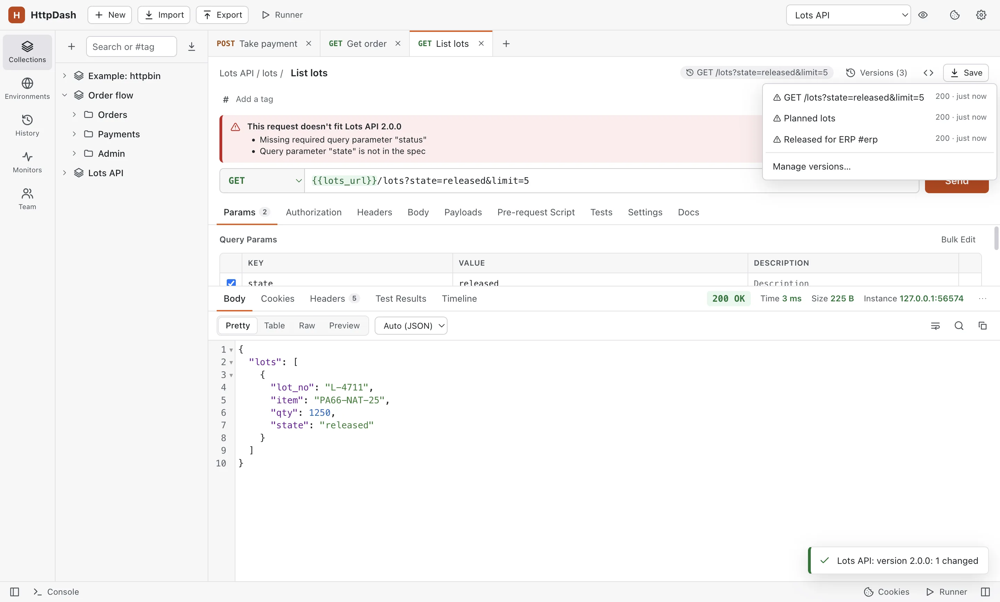 Versions and a spec warning | 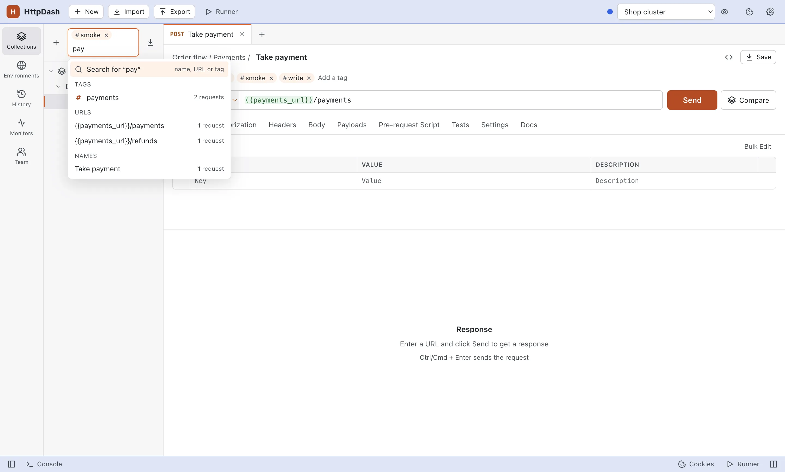 Tags and the search that suggests |
| 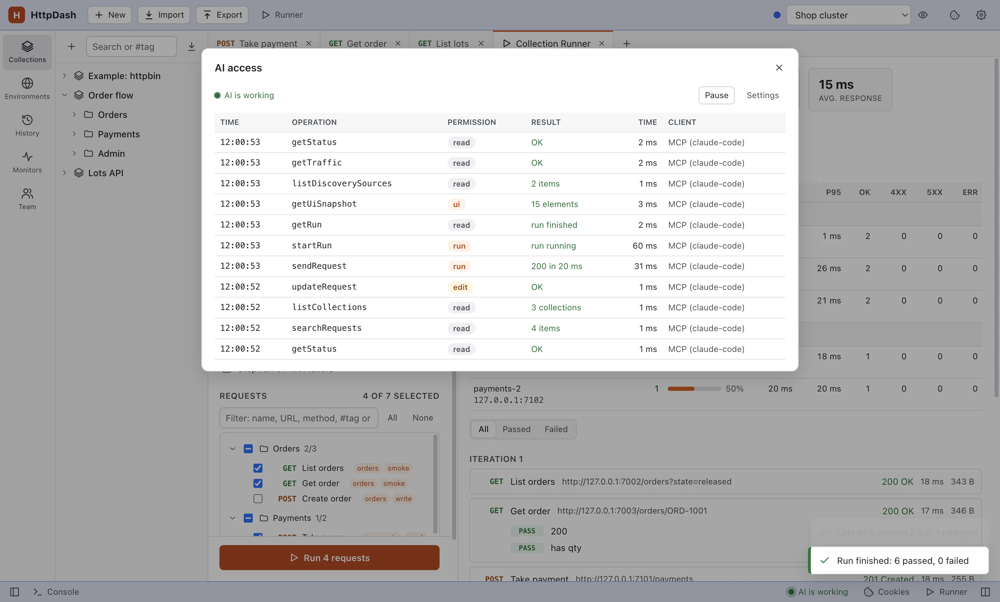 AI agents at work | 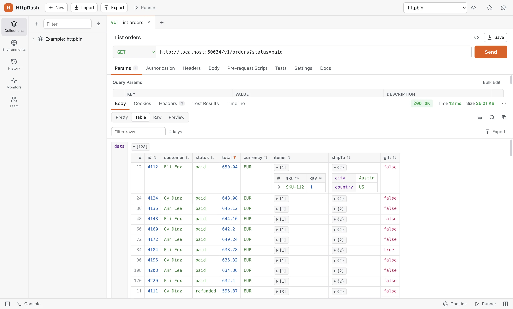 A JSON response as a table |

## Not included

Compared with Postman, these are not implemented: gRPC, Socket.IO and MQTT requests; NTLM, Hawk and Akamai auth; API documentation publishing and hosted cloud sync (team sharing works through git instead).

Scripts run in a sandbox: QuickJS, a separate JavaScript engine compiled to WebAssembly, with a fresh engine per script and limits of 30 seconds and 256 MB. They can't reach Node, files, other processes or HttpDash's own data. They can still send requests with `pm.sendRequest` and read the variables in scope, so review scripts from people you don't trust before running them. See [SECURITY.md](SECURITY.md).

## Website

The site for httpdash.com lives in `website/`: plain HTML, CSS and a little JavaScript, with no build step. The download buttons link to the latest GitHub release.

`.github/workflows/website.yml` uploads it to the web host over SSH whenever `website/` changes on `main`. It needs the `DEPLOY_*` repository secrets listed at the top of that file; until they are set, the job is skipped. To publish by hand instead:

```bash
rsync -rlvz --delete --exclude .well-known --exclude .htaccess website/ <user>@<host>:<web-root>/
```

## Layout

```
src/core/      request engine (no Electron dependency, unit-tested)
  http-client.js  HTTP/HTTPS with timings, redirects, decompression, proxy, keep-alive
  executor.js     variables, auth, bodies, scripts, cookies, health, network -> response
  sandbox.js      runs scripts in a QuickJS (WebAssembly) sandbox
  sandbox-guest.js  the pm.* script API, running inside the sandbox
  vendor/         minified chai for the sandbox (npm run vendor)
  runner.js       collection runner and CSV/JSON data files
  dependency.js   auth dependencies (run the login first)
  discovery.js    service registries (Consul, Eureka, Kubernetes, custom JSON, OpenAPI)
  openapi-sync.js versioned sync of an OpenAPI document into a collection
  request-shape.js  checks a request against its operation in the spec
  balancer.js     spreads requests over instances; traffic by instance, payload and segment
  payloads.js     the variations a request is sent with
  compare.js      compares the answers of every instance
  dns-instances.js  a host's addresses in DNS, for Compare
  health.js       reads a health endpoint around a request
  network.js      addresses, octets, segments, reverse DNS and traceroute
  tunnels.js      SSH (ssh -D) and SOCKS5 tunnels, and which requests go through them
  traffic-report.js  traffic report as CSV, Excel, JSON, Markdown and HTML
  ai-api-spec.js  the AI agents' API (OpenAPI document); ai-server.js serves it, mcp.js bridges MCP
  send-command.js httpdash send: a curl-like command through the running app
  postman.js      Postman / OpenAPI import and export
  curl.js         cURL parser
  codegen.js      code snippet generators
  repo-format.js  team repository file format
  gitsync.js      team sync through git
  update.js       version comparison for Help → Check for Updates
src/main/      Electron main process, IPC, persistence, preload bridge
src/renderer/  UI (plain JS + CodeMirror 5)
test/          node:test unit tests against a local echo server
```

## Contributing

Bug reports, fixes and features are welcome. [CONTRIBUTING.md](CONTRIBUTING.md) explains how to set up, where things live and how to send a pull request. If a Postman collection behaves differently in HttpDash, please [open an issue](https://github.com/gethttpdash/httpdash/issues/new/choose) with it. Report security problems privately, as described in [SECURITY.md](SECURITY.md).

## License

HttpDash is free to use and its source is available, under the [Functional Source License, Version 1.1, ALv2 Future License](LICENSE) (FSL-1.1-ALv2):

- **You may** use HttpDash for any purpose, at work or at home, and read, modify and share its code, except for a *Competing Use*: offering HttpDash, or something built from it, as a commercial product or service that competes with it.
- **After two years**, each version becomes available under the [Apache License 2.0](https://www.apache.org/licenses/LICENSE-2.0) as well, with no restrictions on competing use.
- **Earlier versions:** HttpDash 1.2.0 and earlier were released under the MIT License, and remain so.

Third-party code keeps its own license, such as the bundled copy of chai (MIT).
