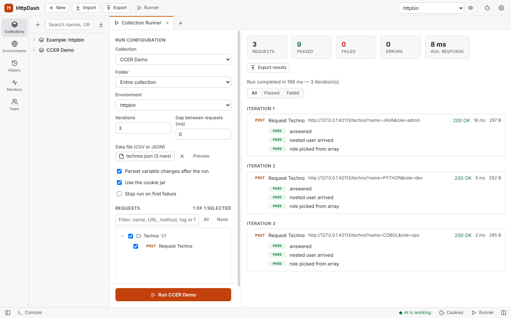

# HttpDash user guide

How every part of HttpDash works, in detail. For what HttpDash is and a quick start, see the [README](README.md); for what changed in each version, the [changelog](CHANGELOG.md).

## Contents

- [Install and update](#install-and-update)
- [Team sharing through git](#team-sharing-through-git)
- [Data files (data-driven runs)](#data-files-data-driven-runs)
- [Command-line runner (CI and schedulers)](#command-line-runner-ci-and-schedulers)
- [AI agents (OpenAPI and MCP)](#ai-agents-openapi-and-mcp)
- [Flows (request orchestration)](#flows-request-orchestration)
- [Monitors](#monitors)
- [Mock server](#mock-server)
- [Secret scan and audit log](#secret-scan-and-audit-log)
- [App lock with LDAP sign-in](#app-lock-with-ldap-sign-in)
- [Import and export everything](#import-and-export-everything)
- [Auth dependencies (auto-refresh tokens)](#auth-dependencies-auto-refresh-tokens)
- [Service discovery (auto-create environments)](#service-discovery-auto-create-environments)
- [Request versions and spec warnings](#request-versions-and-spec-warnings)
- [Tags and search](#tags-and-search)
- [Health while it runs (profiling)](#health-while-it-runs-profiling)
- [Where a request went on the network](#where-a-request-went-on-the-network)
- [Streaming responses (Server-Sent Events)](#streaming-responses-server-sent-events)
- [WebSocket requests](#websocket-requests)
- [Tunnels into internal networks](#tunnels-into-internal-networks)
- [Client certificates and custom CAs](#client-certificates-and-custom-cas)
- [Spoofing Referer, Origin, User-Agent and other headers](#spoofing-referer-origin-user-agent-and-other-headers)
- [Keyboard shortcuts](#keyboard-shortcuts)
- [Features at a glance](#features-at-a-glance)
- [Script sandbox](#script-sandbox)

## Install and update

Download the latest version from the [releases page](https://github.com/gethttpdash/httpdash/releases/latest):

| Platform | Files |
| --- | --- |
| macOS (Intel and Apple Silicon) | `HttpDash-<version>-mac-x64.dmg`, `…-mac-arm64.dmg`, plus `.zip` versions |
| Windows (x64 and ARM64) | `HttpDash-Setup-<version>-x64.exe` / `-arm64.exe` installers, and a no-install `HttpDash-<version>-portable.exe` (x64) |
| Linux (x64 and ARM64) | `HttpDash-<version>-linux-x86_64.AppImage` / `-arm64.AppImage` for any distribution, and `httpdash_<version>_amd64.deb` / `_arm64.deb` for Debian and Ubuntu |

**Updates.** **Help → Check for Updates…** asks GitHub whether a newer release exists and links to it. HttpDash never checks on its own.

**First launch.** A build made without signing certificates is ad-hoc signed on macOS and unsigned on Windows, so:
- **macOS:** the first launch is blocked with "Apple could not verify HttpDash is free of malware". Click **Done**, then open **System Settings → Privacy & Security**, scroll down and click **Open Anyway**. Or run `xattr -dr com.apple.quarantine /Applications/HttpDash.app` in Terminal. (Right-click → Open no longer works on macOS 15 and later.)
- **Windows:** SmartScreen may warn. Choose **More info → Run anyway**.

**From source:** with Node.js 22 or later and git, `npm install` then `npm start`. Building installers is described in [CONTRIBUTING.md](CONTRIBUTING.md#building-packages).

**Your data** is stored as JSON in Electron's `userData` folder (Settings → Data shows the path). Set `HTTPDASH_DATA_DIR` to use a different folder.

## Team sharing through git

Share collections and environments with your team through any git repository: GitHub, GitLab, Bitbucket, Azure DevOps, Gitea or your own server. Open **Team** in the sidebar and connect a repository:

1. **Repository:** enter its URL (HTTPS or SSH), the branch, and optionally a folder, so the workspace can live inside an existing project repository.
2. **Sign-in:** either use this computer's git (SSH keys, Git Credential Manager, stored credentials), or save an access token. Tokens are encrypted with the system keychain (where there is none, as on Linux without a keyring, they are only encoded) and kept out of the workspace, exports and the repository.
3. **Shared items:** tick the collections and environments to share, then click **Sync**.

Teammates connect the same repository and click **Get latest**; the shared items appear in their sidebar with a team badge.

- **Sync** saves your shared items, commits them (with your message, or a summary of what changed), merges teammates' changes and pushes.
- **Get latest** brings in teammates' changes without pushing yours (they are committed locally, so it can still ask about conflicts).
- **Conflicts:** each request is its own file, so two people rarely edit the same file. When they do, HttpDash lists the files and you choose **Keep mine**, **Keep the team's** or **Cancel sync**. Changes to other items merge either way.
- **Secrets stay local:**
  - Secret variables, auth-dependency tokens and OAuth 2.0 access and refresh tokens are written with empty values; everyone keeps their own.
  - Before pushing, the secret scan checks what is about to be shared and warns about plain-text credentials.
- **Open tabs:** tabs follow the team's version unless they have unsaved edits.
- **History:** the last 30 commits are shown, and every sync is recorded in the audit log.

Git must be installed (it usually is on macOS; on Windows, install it from git-scm.com). The repository holds readable JSON, so changes can also be reviewed in pull requests:

```
httpdash.json
collections/orders-api/_collection.json        collection settings and variables
collections/orders-api/orders/_folder.json
collections/orders-api/orders/list-orders.request.json
environments/staging.json
```

| | |
| --- | --- |
|  Connecting a repository |  Choosing whose version to keep |

## Data files (data-driven runs)

A data file runs the same requests once per row: one row per iteration, in the Collection Runner, the command line (`-d`) and for AI agents (`startRun`).

1. **Write the file.** CSV starts with a row of column names; JSON is an array of objects, one per iteration.

   ```csv
   techno,expected_status
   JAVA,200
   "C, C++",404
   ```

   ```json
   [
     { "techno": "JAVA", "expected_status": 200 },
     { "techno": "C, C++", "expected_status": 404 }
   ]
   ```

2. **Use the columns** as `{{techno}}` anywhere a variable works (URL, params, headers, body, auth), and in scripts as `pm.iterationData.get("techno")` (or the legacy `data.techno`).
3. **Pick it in the Runner:** **Data file (CSV or JSON) → Select file**. The button shows the file name and row count, **Preview** shows the rows as they were read, and **×** removes the file.

How it behaves:
- **Iterations:** choosing a file sets **Iterations** to its number of rows. Set more and the rows start over (with 3 rows, iteration 4 uses row 1); set fewer and only the first rows run.
- **Precedence:** a column beats a global, collection or environment variable of the same name; only `pm.variables.set` in a script beats it.
- **CSV:** columns are separated by commas (a file Excel saved with semicolons reads as one column: save it as "CSV UTF-8 (comma delimited)", or use JSON). Quotes work as usual (`"C, C++"`, `""` for a quote), blank lines are skipped and a UTF-8 BOM is fine. Every value is text, so compare with `Number(...)` in tests.
- **Login requests:** auth dependencies still run when the login request is unticked in the run, so you can tick only the requests that use the data.
- **Stop run on first failure** stops the whole run, not just that row's iteration.



### Nested JSON in a data file

Only a row's top-level keys become variables. In a JSON row like `{ "id": 7, "user": { "name": "Ada", "roles": ["admin", "dev"] } }`:

| In the request | Is sent as |
| --- | --- |
| `{{id}}` | `7` |
| `{{user}}` | `[object Object]` (not JSON) |
| `{{user.name}}` | `{{user.name}}`, left as it is (there is no path lookup) |

This is how Postman and Newman behave too, so collections run the same in both. CSV files are always flat: a column named `user.name` is a variable with that whole name.

Scripts get the real objects, so build what the request needs in a pre-request script (on the request, or on its folder to share it):

```js
const user = pm.iterationData.get("user");
pm.variables.set("userJson", JSON.stringify(user));   // the whole object, as JSON
pm.variables.set("userName", user.name);              // a field deep inside
pm.variables.set("firstRole", user.roles[0]);
```

```json
{ "id": {{id}}, "user": {{userJson}}, "role": "{{firstRole}}" }
```

Leave `{{userJson}}` unquoted, since it is already JSON; numbers and booleans such as `{{id}}` can go unquoted too. To send each row as the whole body, use `pm.variables.set("payload", JSON.stringify(pm.iterationData.toObject()))` and make the body `{{payload}}`. Tests can check against the row the same way: `pm.expect(pm.response.json().user).to.eql(pm.iterationData.get("user"))`.

## Command-line runner (CI and schedulers)

Run collections without opening the app, like Postman's Newman. The runner needs Node.js 22+:

```bash
npm install -g github:gethttpdash/httpdash     # or, in a clone: npm run cli -- run …
httpdash list backup.json
httpdash run backup.json -c "Orders API" -e "Staging" --env-var password=$API_PASSWORD -r cli,junit
httpdash send '{{orders_url}}/orders' -e Staging      # one request through the running app, like curl
```

- **Input:** an HttpDash backup (**Export → HttpDash backup**, ideally with "Leave out secrets"), a Postman collection, or a `workspace.json`. When the file has several collections, pick one with `-c` (name or id); `httpdash list` shows them.
- **Environments:** pick one by name from the backup with `-e`, or pass a Postman environment file; `-g` takes a Postman globals file.
- **Secrets in CI:** pass them with `--env-var key=value`.
- **Other options:**
  - `-n` for iterations and `-d data.csv` (or `.json`) for data-driven runs (see [Data files](#data-files-data-driven-runs)).
  - `-f` / `--folder`, `--tag` (repeat it to require several tags), `--bail`, `--delay-request`, `--timeout-request`, `--no-color`.
  - `--socks5 host:port` to send every request through a SOCKS5 proxy; `--no-tunnels` to ignore the tunnels saved in a `workspace.json`.
  - `-k` to skip SSL verification.
  - Client certificates with Newman's flags: `--ssl-client-cert`, `--ssl-client-key`, `--ssl-client-passphrase`, `--ssl-client-cert-list` (Newman's JSON format) and `--ssl-extra-ca-certs`.
  - Reporters: `cli`, `json` and `junit` (JUnit XML is read by Jenkins, GitLab, Azure DevOps and GitHub test reporters). They write `httpdash-report.json` and `httpdash-junit.xml` unless `--reporter-json-export` / `--reporter-junit-export` name another file.
- **What carries over from the app:** auth dependencies and scripts work exactly as in the app, and each request's health line is printed when a health URL is set.
- **Exit codes:** `0` all passed, `1` a test or request failed, `2` bad arguments or input (or the run couldn't start).

## AI agents (OpenAPI and MCP)

AI agents such as Claude can use HttpDash the way you do: read your collections and environments, send requests and read the responses, set up the Runner and get the results, compare instances, check service discovery traffic, add and change requests, and see and use the screen (a snapshot of the visible controls they can click, type into, expand and scroll, plus screenshots).

Turn it on in **Settings → AI access** and choose what agents may do: **Read** (always on), **Run**, **Edit**, **Control the screen**, and **Reveal secrets** (off unless you choose it; secret values and credentials are masked otherwise). It listens on `127.0.0.1` only (port 47823 unless you change it there), every call needs the token shown there (only the OpenAPI document itself is open), and calls from web pages are refused. The status bar shows when an agent is working, and **AI access** lists the last 500 calls (refused ones also go to the audit log); **Pause** stops them, and a new token locks out the old one.

- **Claude Code:** `claude mcp add httpdash -- httpdash mcp` (with the CLI installed: `npm install -g github:gethttpdash/httpdash`)
- **Claude Desktop:** add `{"mcpServers": {"httpdash": {"command": "httpdash", "args": ["mcp"]}}}` to `claude_desktop_config.json`
- **Anything else:** the OpenAPI document is at `http://127.0.0.1:47823/openapi.json` (or your port); send `Authorization: Bearer <token>`.

### Instead of curl: test an endpoint and keep it

An agent (or you) can send through HttpDash rather than with curl, and keep what works:

- **MCP / OpenAPI:** `sendAdHoc` with `collection` (and `folder`) runs the request inside that collection, so its auth and automatic login apply: leave `auth` out and it inherits them. With `save`, a request that succeeded (a status below 400, no failed tests; `saveIf: "always"` keeps any) is kept there, with its response as an example (one per status, the newest kept) and the tag `ai`. A request with the same method and URL in that folder is updated instead of duplicated; missing folders and the collection are created, and without a `collection` it goes into one called "AI requests". Saving needs the **Edit** permission, and the answer says what was saved.
- **Terminal:** `httpdash send` works like curl, through the running app:

  ```bash
  httpdash send '{{orders_url}}/orders/ORD-1001' -c "Orders API" --folder Orders --save -t smoke
  httpdash send POST https://api.example.com/orders --json '{"qty":3}' -e Staging -i
  ```

  `-X`, `-H`, `-d` / `--json` (`@file` reads a file), `-e` for the environment, `-c` / `--folder` / `--save` / `--save-always` / `--name` / `-t` to keep it, `-i` for the status and headers, `-v` for timing, instance, health and network details, and `-f` to exit with 22 on a status of 400 or more (`-f` means `--folder` only for `httpdash run`). `-d` sends form data unless it looks like JSON; `--max-body` caps how much of the body is printed (1 MB by default). The body goes to stdout, so it pipes into `jq`. Exit codes: `0` an answer came back (any status, as curl), `1` the request itself failed (connection, DNS, timeout), `2` bad arguments, `3` HttpDash wasn't reachable or refused (not running, AI access off, a permission off, locked), `22` with `-f`.

### Scripts and data files for agents

- **Scripts:** `createRequest` and `updateRequest` take a request's `preRequestScript` and `testScript`. `createCollection`, `createFolder`, `updateCollection` and `updateFolder` set the scripts that run around every request inside them, and `getCollection` / `getFolder` read them back. This needs the **Edit** permission.
- **Data files:** `startRun` takes `data`, an array of objects with one per iteration, just like a [data file](#data-files-data-driven-runs). Through MCP, `dataFile` takes the path to a CSV or JSON file on your computer instead: `httpdash mcp` reads it on the agent's side and sends the rows, so the app itself never opens a path an agent names. Iterations default to the number of rows, and the Runner shows "Data from AI agent". Without `data`, a data file you chose in the Runner stays in use and `startRun`'s answer names it; `data: []` removes it. The rows travel in the call, which is capped at 1 MB.

For example, an agent can create a folder whose pre-request script turns the nested `user` of each row into `{{userJson}}` (as in [Nested JSON in a data file](#nested-json-in-a-data-file)), add a request that uses it, then call `startRun` with `dataFile: "technos.json"` and read the results with `getRun`.

`httpdash mcp` finds the port and token by itself while the app runs (`--port` / `--token`, or `HTTPDASH_AI_PORT` / `HTTPDASH_AI_TOKEN`, set them explicitly; `--data-dir` or `HTTPDASH_DATA_DIR` points it at another data folder). Start with `getStatus`; `sendRequest` sends a saved request; `startRun` then `getRun` runs the Runner; `getUiSnapshot`, `uiAction` and `takeScreenshot` work the screen.

## Flows (request orchestration)

A **flow** runs requests as a diagram: each request is a node, connections set the order, values pass from one request to the next, and conditions choose which way to go. Open **Flows** in the sidebar and click **+**. A new flow starts as Start → Request → End.

**Nodes**
- **Start:** where the flow begins. Its **inputs** become values such as `{{user}}`. Variables are allowed.
- **Execute:** sends a saved request. Its auth, scripts and auth dependency (automatic login) work as when you send it yourself. **Outputs** take values from the response for later nodes: name `token`, path `data.access_token`. A path is `status`, `time`, `headers.Name`, or a path in the JSON body (`items[0].id`). Later nodes use it as `{{login.token}}`, where `login` is the node's key from its label, shown on the node. `{{login.status}}` and `{{login.time}}` are always there. A failed request stops the flow unless **Carry on when the request fails** is ticked.
- **Condition:** compares values with rules, such as `{{login.status}}` *equals* `200` or `{{orders.total}}` *greater than* `0`. It goes on through its green **true** port when all rules match, or when any one does, as you choose; otherwise through its red **false** port. The rules can be *equals*, *not equals*, *contains*, *not contains*, *greater than*, *less than*, *exists*, *not exists* or *matches* (a regular expression).
- **End:** where the flow ends. **Result tabs** pick what to show. For each tab, choose a node and the path to the part of its response to show, such as `data.items`. It's shown as a table that can be filtered, sorted and exported, the same as the response Table view. **Outputs** are named results built from values.

**Designing**
- **Moving and connecting:** drag a node by its title. Drag from a node's right-hand dot to another node to connect them. A condition has one connection per port.
- **Adding nodes:** **Add Execute / Condition / End** puts the new node after the selected one and connects it.
- **Removing:** click a node or connection, then press **Delete**. Start can't be removed.
- **Zooming:** use **−**, **+** and **Fit** (or Ctrl/Cmd+scroll). A flow opens zoomed to fit.
- **Copying values:** the side panel lists the values the flow makes; click one to copy it.
- **Collapsing nodes:** a node's chevron, or a double-click on its title, folds it to its title bar. Its connections stay, and hovering shows its summary. The **−** button in the toolbar collapses or expands every node.
- **Hiding and resizing panels:** the toolbar buttons hide or show the side panel and the results, so the canvas can fill the tab. Drag the bar above the results to resize them.

**Running**
- **Order:** a node runs once everything before it has run, so a node with two connections in waits for both. The branch a condition doesn't take is skipped, along with everything that only follows from it. Loops aren't allowed.
- **During a run:** each node shows its state as it goes (✓ done, ✕ failed, faded when skipped), and the connections taken are highlighted.
- **Results:** the End node's result tabs come first, then **Outputs**, then **Values** (every value the flow made), then one tab per request with its status, time, tests and response as a table.
- **Environment and variables:** a flow uses the active environment or the one chosen in its settings. Like the Runner, it can keep variable changes made during the run, such as refreshed tokens. Requests can come from different collections; each uses its own collection's variables.

Flows are saved in your workspace.

## Monitors

**Monitors** (sidebar) run a collection or folder on a schedule, from every minute to every 24 hours, against a chosen environment.
- **Results:** success rate, a duration chart, the last 100 runs with the failed tests, and desktop notifications when a monitor fails or recovers.
- **Variables:** changes such as refreshed tokens can be kept.
- **When they run:** while HttpDash is open and unlocked. For round-the-clock checks, schedule the command-line runner with cron, Windows Task Scheduler or your CI.

## Mock server

Each collection has a **Mock server** tab that serves the examples saved on its requests. To save one, send a request, then use the response's "…" menu → **Save as example**.

- **Starting it:** pick a port, an optional delay, and whether other devices on your network may connect; then start it. **Use in an environment** creates (or updates) a copy of your environment, "<collection> (mock)", whose `{{BASE_URL}}`-style variables point at the mock, and switches to it.
- **Matching:** routes match on method and path. `:id` and `{{variable}}` segments match any value, and literal segments win.
- **Choosing an example:** clients can pick a specific one with the `x-mock-response-name` or `x-mock-response-code` header; otherwise the first 2xx example answers. The response's `X-Mock-Example` header names the one used.
- **Other behaviour:**
  - CORS is open to every origin, so any web page in your browser can read the examples while the mock runs.
  - Requests without examples answer 501 with a hint, and unknown paths list the available routes.
  - Recent requests are shown live.
  - Mock servers stop when the app locks or quits (on macOS, closing the window doesn't quit).

## Secret scan and audit log

**Tools → Scan for Secrets** (also in Settings → Security and the Export dialog) looks for credentials typed directly into requests:
- AWS, GitHub, Slack, Stripe and Google keys, private keys and JWTs;
- passwords in URLs, and token, key and password query parameters;
- plain-text auth fields and `Authorization`, `Cookie`, key, token and secret headers (in requests and in saved examples);
- secrets in scripts and bodies;
- sensitive-looking variables that aren't marked secret.

Findings are graded high, medium or low. For headers, auth fields, URLs and variables, one click moves the value into a secret variable (keeping prefixes like `Token {{…}}`) or marks the variable as secret; the rest are edited by hand. Discovery sources, settings and history aren't scanned.

**Tools → Audit Log** keeps a local record (`audit.log`, rotated once at 5 MB to `audit.log.1`) of app starts, sign-ins and locks, lock setting changes, exports and imports, requests sent and compared, WebSocket connections, collection and monitor runs, mock servers, team syncs and AI access calls. It records who, when and what. Request entries store the request's name, method, host, path, status and any error, never headers, bodies or query values. The viewer shows the newest 1,000 entries. You can filter, export (JSON Lines) or clear it; clearing is itself recorded.


## App lock with LDAP sign-in

HttpDash can require a directory (LDAP) sign-in before it opens. Set it up in **Settings → Security**:

1. **LDAP server:**
   - Enter the server address: `ldap://…:389` or `ldaps://…:636`, with optional StartTLS and certificate verification.
   - Choose how to find the user. Either a DN template such as `uid={username},ou=people,dc=example,dc=com`, or search then bind: a service account searches a base with a filter such as `(uid={username})`. Use the second when users live in different branches.
   - Optionally require membership of a group. HttpDash checks `member`, `uniqueMember` and `memberUid`.
2. **Test a sign-in** with your own account.
3. **Turn the lock on**, which is only possible after a successful test of the current settings:
   - Choose which users may unlock.
   - Optionally lock after N minutes of inactivity.
   - Save the one-time **recovery code**.

Once on, HttpDash starts locked. You can lock it any time with the lock button in the top bar or **Ctrl/Cmd+L**.

- **What locked means:** the main process refuses to hand any workspace data to the window until a sign-in succeeds, so nothing is in the window to read.
- **Recovery code:** if the LDAP server is unreachable, the code unlocks HttpDash and turns the lock off, so you can fix the settings.
- **Changing settings:** with the lock on, the LDAP settings are read-only. Turning the lock off requires signing in again.
- **Safety measures:**
  - Empty passwords are refused at sign-in, because many LDAP servers treat them as an anonymous bind that "succeeds".
  - Usernames are escaped before they go into LDAP filters and DNs, and a search that finds more than one user is refused.
  - After 5 failed attempts, each further one waits 30 s longer, up to 5 minutes, until HttpDash restarts.
  - The service-account password is encrypted with the OS keychain (where there is none, as on Linux without a keyring, it is only encoded).
  - Lock settings live in their own `security.json`, which backups never include.
- **Limitation:** the lock protects the app; it does not encrypt your data files on disk.


## Import and export everything

**Export** (top bar) offers two formats:
- **HttpDash backup:** one `.json` file with collections, environments, globals, history, service discovery sources, settings and cookies. Monitors, tunnels, team repositories and request versions stay on this computer.
- **Postman format:** an `httpdash-export-<date>` folder with one `.postman_collection.json` per collection, one `.postman_environment.json` per environment, and a globals file, ready for Postman or teammates. Auth dependencies, discovery sources and WebSocket requests are HttpDash-only, so they are not in these files; tags are kept as `x-httpdash-tags`.

Tick **Leave out secrets** before sharing an export. This empties secret variables and the variables holding auth-dependency tokens, removes credentials typed into auth fields, including those of saved examples and history (references like `{{token}}` are kept), and drops discovery tokens and secret-looking discovery headers, the proxy password, certificate passphrases and cookies. It does not touch credentials typed straight into headers, URLs, scripts, bodies or saved responses, or the resolved URLs and headers in history: run **Scan for Secrets** first (it's in the Export dialog). Without it, the file contains your credentials.

**Import** accepts all of these, and several files can be selected at once (for example a whole Postman export folder). For a backup, you choose:
- **Merge:** adds everything; collections, environments and discovery sources with the same id are added as copies marked "(imported)", history you already have is skipped, existing global keys are kept, and cookies with the same name, domain and path are replaced. Your settings stay as they are.
- **Replace:** swaps your collections, environments, globals, history and discovery sources for the backup's, and applies its settings over yours (a backup without cookies keeps your cookies). It asks for confirmation first.


## Auth dependencies (auto-refresh tokens)

A collection, folder or request can name another request, such as **Login**, to run first when the token it needs is missing or expired. Set it up in the **Authorization** tab under **Auth dependency**:

1. Set the collection's auth to **Bearer Token** with `{{token}}`.
2. Choose **Run a request first** and pick the login request.
3. Fill in where the token sits in the login response, for example `access_token` or `data.access_token`, and optionally the `expires_in` path.

On every send, HttpDash checks `{{token}}`:
- **Empty or expired:** it runs the login request first, saves the new token (and its expiry) in the active environment (or the collection variables or globals, if you choose), then sends your request.
- **Still valid:** it sends your request straight away.

Expiry comes from the expiry variable, which is computed from `expires_in`. If there's no expiry variable, it uses a JWT token's `exp` claim; with neither, the token is used until a request gets a 401. The token is refreshed 30 seconds early by default. **Before every request** runs the login every time instead, and **Clear token** forgets the saved one.

More details:
- **Retry on 401:** on by default, if the server still answers 401, it refreshes the token and retries once.
- **Logging in by hand:** sending the login request yourself saves its token too.
- **Inheritance:** requests and folders inherit the setting, or can override it or turn it off.
- **No loops:** the login request never depends on itself, and dependencies nest at most 3 deep.
- **Collection Runner:** it logs in once and reuses the token, even if the login request is unticked in the run.
- **Visibility:** the response shows a banner when a dependency ran, and the Timeline shows its details.

Auth dependencies are saved in HttpDash's workspace. Postman's export format has no field for them, so they are not included when you export to Postman.


## Service discovery (auto-create environments)

Point HttpDash at a service registry and it builds an environment with one variable per service. For example, `{{orders_url}}` = `http://10.0.1.5:8080`, so requests can use `{{orders_url}}/api/orders`.

To add a registry, open **Environments** in the sidebar and click **Service discovery → +**.

| Registry | What it reads |
| --- | --- |
| Consul | `/v1/catalog/services` plus each service's instances, only those passing health checks unless you untick it. Options: ACL token, datacenter, tag filter, http/https. |
| Eureka (Spring Cloud) | `/eureka/apps`, instances with status UP only unless you untick it. Uses each app's home page URL or its host and port. |
| Kubernetes | Services in a namespace (or `*` for all, named `namespace_service`), using a service-account bearer token and an optional label selector. The address can be the cluster DNS name, the cluster IP, the external LoadBalancer address, or **Pods**: every ready pod behind the Service, so requests can be spread over them and counted per pod (the other modes give one instance per service). |
| Custom JSON | Any endpoint returning a list of services or a `{ "name": "url" }` map. You set the list path, the name field, and a URL field or template such as `http://{host}:{port}`. |
| OpenAPI document | The document's server becomes a base URL variable, and every operation becomes a request in a collection that follows the document (see below). |

- **Preview services** shows what would be created, without changing anything.
- **Create environment** makes the environment the first time.
- **Sync to environment** (or **Re-sync** on the environment, **Sync now** in the sidebar) updates the same environment in place: changed URLs are updated, new services are added, and services that vanished are removed (unless you tick "keep"). Variables you added yourself, such as API keys, are never touched, unless one has the same name as a discovered service.
- **Variable names** follow a pattern, `{name}_url` by default: `{name}` is the service name in lower_snake_case and `{NAME}` in UPPER_CASE, so `{NAME}_BASE` gives `ORDERS_BASE`.
- **Startup sync:** each source can be set to sync automatically when HttpDash starts. An OpenAPI source only checks, and tells you when a new version is waiting.
- **Settings:** registry requests use your proxy settings, and SSL verification can be turned off per source. It starts off for Kubernetes, whose API servers often have self-signed certificates.


### A collection for every discovered service

A Consul, Eureka, Kubernetes or custom JSON source can also build a collection for each service it finds, from the service's own OpenAPI (Swagger) document. Tick **Also create a collection from each service's API document** on the source, then sync:

- **Where to look:** each service's URL plus a path, tried in order until one returns an OpenAPI document, in JSON or YAML. Leave **Where each service publishes it** empty for the common ones: `/v3/api-docs` and `/v2/api-docs` (Spring), `/openapi.json` (FastAPI), `/swagger/v1/swagger.json` (.NET) and `/api-json` (NestJS). Or list your own, separated by commas. A full URL works too.
- **What you get:** one collection per service, with a request for every operation. The collection is named after the document's title, or after the service when the title is a framework default such as "OpenAPI definition". Requests use the service's own variable, such as `{{orders_url}}`, so load balancing, traffic by instance and Compare apply, and spec warnings check them against the document.
- **Keeping up:** each sync brings every collection in step with its service's current document, in the same way as an OpenAPI source: new operations are added, ones that left the document are removed unless you changed them, and your edits, scripts and tests are kept. The results table shows each service's collection, its version and what changed, or why it has none (no document, or the service didn't answer).
- **At startup**, if the source syncs automatically, only missing collections are created. Existing ones are updated when you sync by hand.
- **Services that disappear** keep their collection; the report lists them. A collection you delete is created again on the next sync, unless you untick the option.
- **Safety:** each service only gets a plain GET for its document. The registry's token and extra headers are never sent to the services.

### OpenAPI documents, versioned

A source pointed at an OpenAPI (Swagger) document, JSON or YAML, keeps a collection with one request per operation. Each sync records the document's version and a fingerprint, so an unchanged document changes nothing. A new one is compared with the last: added, changed and removed operations are listed before anything is written, and you apply them when you're ready. Your own edits (values, scripts, tests, requests you added) are kept, and the report says where the document changed something you edited too.

Each operation's shape is kept as well, so a request, and each of its versions, is checked against the document. A banner says when the operation is gone or deprecated, a required parameter or field is missing, a value isn't one the spec allows, or it sends something the spec doesn't know.

### Load balancing and traffic by instance

When a service has several instances, requests that use its variable can go to **the first instance**, **each in turn** (round robin) or **a random one**, in Send, the Runner and Monitors. Unhealthy instances are skipped. Behind a load balancer, set the **instance header** (such as `X-Served-By`) and requests are counted by the instance that answered.

The source's **Traffic** page shows, live, what each instance answered: requests, share, p50 and p95 times, status codes and connection errors. Slow and failing instances are flagged, and so are instances that left the pool. The latest requests are listed with the gap between them. Export the report to Excel, CSV, PDF, an image, an HTML page, Markdown or JSON.

### Payloads

Give a request the variations it should be called with (typed in, or imported from CSV or JSON rows) and send them in turn or at random. Each payload has its own rotation over the instances. Traffic is counted per payload too, so a payload that is slow on every instance can be told apart from an instance that is slow for every payload. The same goes for network segments: **By network segment** appears when instances answer from more than one.

### Compare instances

**Compare**, next to Send, sends the request to every healthy instance of the service in its URL (the source is synced again first), or to every address its host resolves to in DNS (round-robin DNS, Kubernetes headless services; this uses your own resolver and needs a direct connection, not a proxy). It compares the answers (status, headers and every field of a JSON body) and names the instance that answered differently, with each difference: `X-Version` 2.3.0 where the others say 2.4.1, a missing `qty`, a different `state`.

- Values that differ on every instance by nature (ids, timestamps, the instance's own name) are set apart, and can be ignored for the request with one click (`items[*].updatedAt` covers every item).
- Headers that always vary, such as `Date` and request ids, are ignored.
- Each instance's status, time, tests and address are listed, and **Show** opens its full answer.
- Any method but GET, HEAD and OPTIONS asks first, since it runs once per instance.

## Request versions and spec warnings

Every distinct version of a request you send by hand (method, URL, params, headers, body, auth) is kept with the response it got. Open **Versions** in the request's header to switch back to one and see its response straight away. Sending the same thing again doesn't make a new version. Name and tag versions in **Manage versions**; named and tagged versions show up in the sidebar search. Runs and monitors don't add versions, and versions stay in your workspace (they aren't exported or shared). Each request keeps 50, the named and tagged ones longest, with the first 64 KB of each response.

When a request comes from an OpenAPI source, it and each of its versions are checked against the document: versions that no longer fit are marked ⚠ in the versions menu.

## Tags and search

Tag requests (`smoke`, `orders`, `admin`, up to 20 of 40 characters each) in the field under the request's name, which suggests the tags already in use. The sidebar search becomes a dropdown, built from every request's tags, methods, URLs and names and from named versions, most used first. What's typed in open tabs counts before it's saved, and open tabs that aren't saved yet are listed under **Open tabs, not saved**. Pick a suggestion and it becomes a chip; chips combine (every tag, any of the methods, plus the text you add). `tag:`, `method:`, `url:`, `name:` and `version:` narrow the suggestions.

Typed text is matched word by word, in any order. Each word can be in the request's name, URL, tags or method, or in the name of its folder or collection. So `create order` finds "Create new order", `post orders` finds the POST requests on `/orders`, and `Admin` lists everything in the Admin folder. When nothing matches exactly, the search allows one typo in words of 5 letters or more: a letter wrong, missing or extra, or two letters swapped, so `ordrs` finds "orders". A note above the results says these are close matches. What matched is highlighted in the names of requests, folders and collections, and in tags. A request with several tags shows the one that matched. URLs are searched both as written (`{{base_url}}/orders`) and with their variables filled in from the request's collection, the active environment and globals, so `api.example.com` finds them too. Secret variables are left out. A request with nothing highlighted matched on its URL or method. In the sidebar, suggestions open beside it, so the results stay in view while you type.

- **Recent searches:** click into the empty search field to see your last searches (up to 10, newest first) and pick one to run it again. Hover one and click **×** to remove it. A search counts once you leave the field with something in it. One that only grows the last search, such as `ord` then `orders`, replaces it.
- **Click a tag to filter by it:** a tag on the request screen, under its name, or a tag in the sidebar tree adds that tag to the sidebar search. The sidebar opens if it was hidden.

The Runner's request picker uses the same search, so picking the `smoke` tag then **All** runs the smoke tests, and the CLI has `-t` / `--tag`. Tags travel with team sharing and survive a Postman export and import.

## Health while it runs (profiling)

Give a request, a folder or a collection a **health URL**, and HttpDash reads it before the request is sent, while it is in flight, and after it answers. You see what the server went through while it handled your request: connections or transactions held, queues, memory, a database that went down.

Set it up in a folder's or collection's **Health** tab, or in a request's **Settings** tab:

- **Health URL:** a path such as `/healthz` or `/actuator/health` is read on each request's own host. So a request sent to one instance (through service discovery or Compare) reads that instance's health. A full URL such as `{{mes_url}}/healthz` is read as written.
- **Read every (ms):** how often to read it while the request is in flight, 250 ms by default. The first reading goes out with the request, so even a fast request has one, and readings never overlap.
- **Only these fields:** optional, one JSON path per line. `db.transactions` covers everything under it.
- **Send the request's Authorization header:** for health endpoints that need it.
- **Read it now:** reads the endpoint once and lists every field, with **Watch** to pick the ones you care about.

The response gets a **Health** tab:
- whether the service said it was healthy in every reading (a 4xx/5xx answer, `ok: false`, `healthy: false`, or a `status` other than `UP`, `ok`, `pass`, `healthy`, `green` or `ready`, in any case, counts as unhealthy)
- the fields that changed, with their value before, their range during and their value after, and a small chart of each numeric field over time with the request's own span shaded
- the fields that didn't change, and every reading with its status and how long the health endpoint took to answer.

Health readings never fail the request itself; an endpoint that can't be reached is shown as an unhealthy reading. The Collection Runner shows one line per request (`healthy throughout; db.transactions.waiting 0 → 3 → 0`), the CLI prints it under each request, and the AI API's `sendRequest` returns it.

## Where a request went on the network

The **Timeline** tab has a **Network** section for every request:

- **Host:** the name you called, and the names it is an alias of (CNAME), in order.
- **Connected to:** the address the request was sent to, split into its octets with the network segment highlighted (`10 . 42 . 7 . 31`, segment `10.42.7.0/24`). It also shows the kind of address (private, shared/VPN `100.64.0.0/10`, loopback, link-local, multicast, benchmark, public), its reverse-DNS name (often the host, rack or data center), and whether it sits on one of your own computer's segments.
- **From:** your own address and the network adapter the request left from (Ethernet, Wi-Fi, a VPN).
- **Resolves to:** every address the name resolves to, in the order your resolver gives them, each with its segment, kind and TTL, and the one that was used marked. If DNS servers asked directly give a different answer than your computer's resolver (hosts file, VPN or split DNS), it says so.
- **Trace route:** runs your system's `traceroute` (`tracert` on Windows) and lists each hop (up to 20) with its address, segment and time. It can take up to a minute, and some networks don't answer.

Through a proxy, the address shown is the proxy's, and the trace says so. Segment size is /24 for IPv4 and /64 for IPv6; change it for this section, or turn tracing off, in **Settings → General**. Lookups are cached for a minute, so a collection run asks once per host.

For services from service discovery, the **Traffic** page adds a **By network segment** table when instances answer from more than one segment, so a slow data center or VLAN stands out from a slow instance (always /24 and /64). It's in every export format except CSV, which has the instances only, and **Compare** shows the address each instance answered from.

## Streaming responses (Server-Sent Events)

When a response is `text/event-stream`, as with AI APIs that stream their answers, HttpDash shows each event the moment it arrives instead of waiting for the end. It works with any method and body, so a `POST` to a completion endpoint just works.

- While streaming, the response pane lists events live, with the time since the request was sent, and the Send button becomes **Stop**.
- **Stop** keeps everything that arrived, so you can inspect a long or endless stream.
- Afterwards, the **Events** view lists every event (name, data, id); click one to see its data pretty-printed and copy it. The raw stream is still in **Raw**, and test scripts run as usual when the stream ends.
- Events are parsed exactly as browsers do: multi-line `data`, `event`, `id`, `retry` and comments, with any line endings.

## WebSocket requests

Create one with **New → WebSocket Request**, or **Add WebSocket request** on a collection or folder. It's saved like any request (shown as **WS**), so it lives in collections and syncs with your team.

- **Connect** to a `ws://` or `wss://` URL. `{{variables}}` work in the URL, headers and messages.
- **Handshake:** your headers, plus the auth inherited from the collection or folder (Bearer, Basic, API key, OAuth 2.0…) and matching cookies, are sent with the handshake. Subprotocols go in **Settings**. Client certificates, trusted CAs, the proxy and SSL verification apply as for HTTP. Click the "Connected" line in the log to see the exact handshake.
- **Messages:** write text or JSON and press **Send** (or Ctrl/Cmd+Enter, which connects first if the tab isn't connected). Save messages you use often and reuse them with one click.
- **Log:** everything sent (↑) and received (↓) with times and sizes. Click a message to see it pretty-printed and copy it; filter as you type. Pings are answered automatically, and the close code and reason are shown when the connection ends.
- If the server refuses the upgrade, its status and response body are shown, so a 401 or 403 is easy to diagnose.

The collection runner, mock servers and Postman export skip WebSocket requests.

## Tunnels into internal networks

Reach services on a private network (a plant, a data center, a Kubernetes cluster) without a VPN. Add tunnels in **Settings → Tunnels**:

- **SSH jump host:** HttpDash runs your system's `ssh` with dynamic port forwarding (`ssh -D`), so your keys, `ssh-agent`, `~/.ssh/config` and known hosts work as they do in a terminal. Optional: user, port, key file, and other jump hosts to go through first (`ssh -J`). It opens on first use and stays open; if it drops, the next request opens it again. ssh runs in batch mode, so it never waits for a password: use a key. A new host key is refused unless you tick **Accept a new host key the first time**, and a changed one is always refused.
- **SOCKS5 proxy:** any SOCKS5 server, with an optional user name and password.

Each tunnel carries the hosts you list, one per line: names with `*` wildcards (`*.mes.corp`) or address ranges (`10.42.0.0/16`). An environment can instead send all its requests through one tunnel (**Tunnel** under its color), or through none. Host names are resolved on the far side, so internal DNS names work.

Everything goes through the tunnel: Send, the Runner, Monitors, Compare, health reads, WebSockets, and the app's own calls such as service discovery syncs, OAuth sign-ins and imports from a URL. A Consul server inside a plant is reached the same way as its services. The Timeline shows the time the tunnel took and notes that the address and route are on the far side, and the status bar shows while a tunnel is open (red if it failed). **Open** / **Check** opens a tunnel and can try a `host:port` through it.

The CLI uses the tunnels saved in a `workspace.json` from HttpDash's data folder (with the environment's choice; HttpDash backups don't include tunnels), or `--socks5 host:port` for every request, for example through an `ssh -D` started by your CI job. `--no-tunnels` ignores the saved ones.

## Client certificates and custom CAs

For APIs that use mutual TLS, add a client certificate in **Settings → Certificates**:

- **Host:** a name such as `api.example.com`, or a wildcard such as `*.example.com`. Optionally add a port; leave it empty to match any port.
- **Files:** a CRT and KEY file (PEM), or a PFX/P12 file. Add the passphrase if the key or PFX has one.
- The first enabled certificate that matches the request's host is used, on every hop of a redirect and through a proxy. The response **Timeline** shows which one was sent.
- Certificate files are read when needed, so renewed certificates are picked up without restarting.

**Certificates installed on this computer** are trusted by default, as in a browser: HttpDash reads your system's store (macOS Keychain, Windows certificate store, the Linux system bundle) as well as its built-in list, so a company CA that IT has installed just works. You can turn this off in **Settings → Certificates**.

**CA certificate** adds a certificate authority from a PEM file to the trusted ones, for CAs that aren't installed on the computer, so internal HTTPS servers work without turning off SSL verification.

TLS settings are built once and reused, so client certificates and extra CAs don't slow requests down.

Passphrases are left out of exports when you tick **Leave out secrets**. If a server asks for a certificate you haven't added, or the passphrase is wrong, the error says so in plain words.

## Spoofing Referer, Origin, User-Agent and other headers

Requests are sent from Node's HTTP stack, not a browser, so none of the browser's "forbidden header" rules apply. Whatever you put in the **Headers** tab is sent exactly as written, including:
- `Referer`, `Origin` and `User-Agent`
- `Host` (useful for virtual hosts)
- `Cookie` (overrides the cookie jar for that request; after a redirect the jar's cookies are sent, and a custom `Host` is dropped)
- `X-Forwarded-For` and other `Sec-*` headers

The header-name field autocompletes common headers. A custom `Referer` is kept when redirects are followed.

Some of these are set automatically if you don't set them (User-Agent, Accept, Accept-Encoding, Cache-Control unless **Send no-cache header** is off, Host, Content-Type, Content-Length), as are the auth header and the cookie jar's `Cookie`. Your own value always wins; **Show auto-generated** in the Headers tab lists the first group. The default User-Agent can be changed in Settings.

## Keyboard shortcuts

Ctrl on Windows and Linux, Cmd on macOS. They also appear in the menus.

| Shortcut | What it does |
| --- | --- |
| Ctrl/Cmd+Enter | Send the request. On a WebSocket tab: connect, and once connected, send the message |
| Ctrl/Cmd+Z | Undo the last change to the request |
| Ctrl/Cmd+Shift+Z, Ctrl/Cmd+Y | Redo |
| Ctrl/Cmd+F | Find: in the editor you're typing in, otherwise in the response (or its table or message filter) |
| Ctrl/Cmd+Shift+F | Search requests in the sidebar |
| Ctrl/Cmd+T | New request |
| Ctrl/Cmd+S | Save the request |
| Ctrl/Cmd+W | Close the tab |
| Ctrl+Tab, Ctrl+Shift+Tab | Next and previous tab (also Ctrl+PageDown / PageUp, and Ctrl/Cmd+Shift+] / [) |
| Ctrl/Cmd+1 … 8, Ctrl/Cmd+9 | That tab, and the last tab |
| Ctrl/Cmd+O | Import |
| Ctrl/Cmd+, | Settings |
| Ctrl/Cmd+\\ | Show or hide the sidebar |
| Ctrl/Cmd+Alt+C | Show or hide the console |
| Ctrl/Cmd+= (or +), Ctrl/Cmd+−, Ctrl/Cmd+0 | Zoom in, zoom out, back to 100% (also in **Settings → Appearance**) |
| Ctrl/Cmd+L | Lock HttpDash (with the app lock on) |
| Ctrl/Cmd+/ | Comment or uncomment lines in a script editor |

**Undo and redo** work across the whole request: typed text in any of its fields, and changes such as a deleted header, a new method, a different body type or a version you switched to. Typing in one field without a pause is one step. Each tab keeps its own history until it's closed (it isn't saved), and undoing back to the saved request makes the tab clean again. Other fields, such as the sidebar search, a response filter or a dialog, undo their own typing.

## Features at a glance

**Requests**
- Any HTTP method, URL bar with `{{variable}}` highlighting, hover tooltips and autocomplete
- Query params table synced with the URL, path variables (`/users/:id`), headers with bulk edit
- Bodies: raw (JSON / XML / HTML / JavaScript / text, with beautify and JSON linting), `form-data` with file uploads, `x-www-form-urlencoded`, binary file, GraphQL (query + variables)
- Auth: inherit from parent, Basic, Bearer, API key (header or query), Digest, AWS Signature v4, and OAuth 2.0 with every common grant:
  - **Authorization Code**, with or without **PKCE**, and **Implicit**: sign in in an HttpDash window, which catches the redirect to any registered callback URL, or in your own browser with a callback on `127.0.0.1` (RFC 8252)
  - **Client Credentials** and **Password**
  - Refresh tokens, expiry display and "Sign Out of Providers". Tokens you get by signing in are never shared through team sync; each person keeps their own.
- Per-request settings: follow redirects, SSL verification, cookies, timeout
- Paste a cURL command into the URL bar to import it
- **Tags** on requests, suggested as you type, and **versions**: the last 50 versions you sent by hand are kept with their responses, to switch back to in a click
- Connections are kept open and reused (keep-alive), so repeat requests skip DNS, TCP and TLS

**Responses**
- Status, time and size, with a breakdown of DNS / connect / TLS / first byte
- Pretty (JSON / XML / HTML formatting), **Table**, Raw, Preview (sandboxed HTML, images) and Visualize (`pm.visualizer.set` with Handlebars-style templates)
- **Table view** for JSON: arrays of objects become sortable tables, objects become key/value tables, and nested values open as tables in place. Filter rows as you type. Long tables are virtual (only the rows on screen are drawn), so a 100,000-row response opens in about 0.1 s and scrolls smoothly, even when the big array is nested inside another object.
- **Export** a table as an Excel workbook, CSV (UTF-8, opens correctly in Excel) or a PNG image, following the current filter and sort. Nested objects become dotted columns (`address.city`); Excel cells keep numbers and booleans typed, with a bold, frozen header.
- Search, line wrap, copy, save to file, save as example
- Large responses (over about 2 MB of text by default) show their first 512 K characters until you click **Show all**, so the window never freezes; Table, Visualize, Events and image previews always use the whole response
- Headers, cookies, test results with filters, and a timeline showing the request actually sent and any redirects
- **Network** (in the timeline): every address the host resolves to, the one it connected to in octets and segments, your network adapter, and a route trace
- **Health:** what the service's health endpoint said before, during and after the request, when a health URL is set
- **Compare:** the same request sent to every instance of a service, and the one that answered differently

**Scripts** (Postman-compatible `pm` API)
- Pre-request and test scripts on collections, folders and requests, run in Postman's order
- `pm.environment` / `globals` / `collectionVariables` / `variables` / `iterationData`, `pm.request` (headers, URL, query, body), `pm.response` (`json()`, `text()`, `headers`, `code`, `responseTime`)
- `pm.test`, `pm.expect` (Chai), `pm.response.to.have.status(...)` / `.header(...)` / `.jsonBody(...)` / `.jsonSchema(...)` / `.be.success` and similar
- `pm.sendRequest`, `pm.setNextRequest`, `pm.cookies`, `pm.visualizer`, `pm.execution.skipRequest`
- `CryptoJS` (MD5, SHA-1/224/256/384/512 and their HMACs, encoders), `atob` / `btoa`, `Buffer`, `URL` / `URLSearchParams`, `TextEncoder` / `TextDecoder`, `setTimeout`, `console.*` output in the Console panel, and legacy `tests[...]`, `postman.*`, `responseBody`
- `require` for `chai`, `crypto-js`, `util`, `url` and `buffer`
- Every script runs in an isolated sandbox with no access to Node or your files
- Snippet library in the script editor

**Organisation**
- Collections and nested folders with drag-and-drop, rename, duplicate, delete and "Copy as cURL"
- Collection / folder settings: description, auth, scripts, collection variables
- Environments (with secret values and a color that tints the top and bottom bars while active), globals, environment quick look, dynamic variables (`{{$guid}}`, `{{$timestamp}}`, `{{$randomEmail}}`, …)
- A sidebar search that suggests from every request's name, URL, method and tag, with chips that combine
- History grouped by day (an entry of a saved request opens that request), multiple tabs with unsaved-change tracking, all restored on restart
- Preview tabs: a single click opens a temporary tab (in italics) that the next click replaces; edit it, send it, double-click it or choose **Keep open** to keep it

**Collection Runner**
- Run a collection or folder, and pick its requests from a tree or by tag; environment, iterations and a gap in milliseconds between requests
- 500 requests with scripts and tests in about a third of a second (`npm run bench` compares it with Newman and Bruno)
- CSV / JSON [data files](#data-files-data-driven-runs) (one iteration per row), `pm.setNextRequest` flow control, stop on failure
- Live results with per-request tests, request/response details and exportable JSON results
- Optionally persists variable changes made during the run

**Import / export & tools**
- Import HttpDash backups, Postman collections (v2.0 / v2.1), environments and globals, OpenAPI 3.0 / 3.1 and Swagger 2 (JSON or YAML) and cURL; drag files onto the window to import
- OpenAPI imports keep each operation's examples (request bodies, parameters and responses), so the collection's **mock server** works right away, and turn security schemes into auth settings (Bearer, Basic, API key, and OAuth 2.0 including PKCE). They follow `$ref`s within the document (references to other files aren't followed), read OpenAPI 3.1 types, and handle large specs: GitHub's 10 MB API description imports in about a second.
- Export everything as a restorable backup or as Postman files, or export single collections, environments and globals
- Code generation: cURL, raw HTTP, JavaScript fetch, Node.js Axios, Python requests, Go, PHP cURL, C# HttpClient, Java OkHttp, PowerShell, wget
- Cookie manager (view / add / edit / delete per domain)
- Settings: timeout, redirects (and how many), SSL verification, connection reuse, cookie jar, no-cache header, HTTP proxy (including HTTPS via CONNECT, with auth and bypass list), tunnels (SSH jump hosts and SOCKS5) into internal networks, network tracing and segment size, user agent, response size limit and large-response size, history length, light / dark / system theme, zoom (70% to 130%), editor font size, stacked or side-by-side layout; plus certificates, security (app lock), AI access and data
- Console panel with network and script logs; [keyboard shortcuts](#keyboard-shortcuts) for sending, find, undo and redo across the whole request, and moving between tabs

## Script sandbox

Scripts run in a sandbox: QuickJS, a separate JavaScript engine compiled to WebAssembly. Each request (with its collection and folder scripts and auth dependencies) or collection run gets its own engine, limited to 256 MB, and every script in it gets a fresh context with its own globals, limited to 30 seconds and a fixed stack depth. They can't reach Node, files, other processes or HttpDash's own data. They can still send requests with `pm.sendRequest` and read the variables in scope, so review scripts from people you don't trust before running them. See [SECURITY.md](SECURITY.md).
